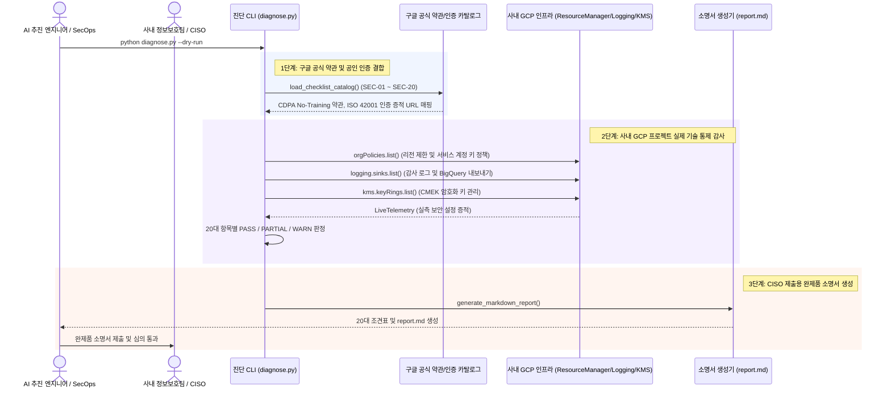

<!--
Copyright 2026 Google LLC. All Rights Reserved.
SPDX-License-Identifier: Apache-2.0

NOTICE: This code/repository is owned by Google LLC and provided under the Apache-2.0 License.
It is strictly provided as an EXAMPLE/REFERENCE ONLY and is NOT INTENDED FOR PRODUCTION USE.
All contents, designs, and code examples are subject to change, modification, or removal at any time without notice.

[고지 사항] 본 저장소 및 문서는 구글 (Google LLC) 소유이며 Apache 2.0 라이선스 하에 예시 (Sample) 용도로 제공된다.
프로덕션 환경용이 아니며, 사전 통지 없이 언제든지 수정, 변경 또는 삭제될 수 있다.
-->

# 기술 상세 설계서 (TDD): Gemini 도입을 위한 한국형 AI 보안성 심의 체크리스트 진단기 (korea-ai-security-checklist)

## 1. 시스템 아키텍처 및 런타임 상호작용 시퀀스

본 도구의 런타임 제어 및 데이터 상호작용 흐름은 아래 시퀀스 다이어그램과 같다. 구글 공식 보안 약관(No-Training, ISO 42001)과 사내 GCP 인프라의 실제 보안 통제(VPC-SC, CMEK, Audit Logs)를 결합하여 20대 핵심 보안 체크리스트를 실사하고 완제품 소명서(`report.md`)를 도출한다.

---

## 2. 요구 사항 추적성 매핑 (Traceability Matrix)

| 비즈니스 요구 사항 (BRD) | 기능적 기술 요구 사항 (FR) | 비기능적 기술 요구 사항 (NFR) | 구현 파일 및 모듈 |
| :--- | :--- | :--- | :--- |
| **BR-01** (20대 핵심 보안 심의 카탈로그 표준화) | **FR-01** (20대 핵심 보안 체크리스트 카탈로그 내장) | **NFR-03** (보안 규약 준수) | `diagnose.py` (`CHECKLIST_ITEMS`), `docs/CHECKLIST.md` |
| **BR-02** (구글 공식 약관 및 인증 소명 결합) | **FR-02** (공식 정책/인증 소명 자동 결합) | **NFR-03** (Bare URL 준수) | `diagnose.py` (`load_catalog`) |
| **BR-03** (사내 GCP 인프라 기술 통제 실측 감사) | **FR-03** (실시간 GCP 리소스 보안 감사) | **NFR-01** (최소 IAM 권한 준수) | `diagnose.py` (`audit_live_infrastructure`) |
| **BR-04** (CISO 제출용 완제품 소명서 생성) | **FR-04** (CISO 제출용 완제품 소명서 생성) | **NFR-04** (리포트 절대 경로 저장 보장) | `diagnose.py` (`generate_markdown_report`), `report.md` |
| **BR-05** (사내 거버넌스 4대 필수 라벨링 준수) | **FR-05** (사내 거버넌스 4대 필수 라벨링 적용) | **NFR-03** (보안 규약 준수) | `README.md`, `diagnose.py` |

---

## 3. 기능적 기술 요구 사항 (Functional Requirements)

| 요구 사항 ID | 연관 BR | 기술 요구 사항 명칭 | 구현 상세 및 검증 기준 |
| :--- | :--- | :--- | :--- |
| **FR-01** | **BR-01** | **20대 핵심 보안 체크리스트 카탈로그 내장** | AI 거버넌스(4문항), 데이터 주권(2문항), 암호화(2문항), 네트워크/접근통제(3문항), 감사로깅/보존(3문항), AI안전/개인정보(2문항), 공급망/라이프사이클(4문항) 등 총 20개 문항을 정규화한다. 상세 체크리스트 정의 및 법적 소명 매핑은 CHECKLIST.md를 표준 단일 진실 공급원(SSOT)으로 삼는다. |
| **FR-02** | **BR-02** | **공식 정책/인증 소명 자동 결합** | ISO/IEC 42001, No-Training, No-Human-Review 등 기술적으로 직접 쿼리하기 어려운 정책적 항목에 대해 구글 공식 보안 약관(CDPA) URL과 공인 소명 문구를 완벽히 자동 매핑한다. |
| **FR-03** | **BR-03** | **실시간 GCP 리소스 보안 감사** | gcloud resource-manager org-policies list 명령 등을 통해 핵심 보안 조직 정책, 리전 엔드포인트 격리 및 Audit Logs 활성화 상태를 실시간 대조하여 PASS/WARN 판정을 내린다. |
| **FR-04** | **BR-04** | **CISO 제출용 완제품 소명서 (report.md) 생성** | 터미널 출력과 함께 표 서식의 마크다운 소명서(report.md)를 자동 생성(덮어쓰기)하여 즉시 사내 결재 및 제출 증적으로 활용할 수 있도록 지원한다. |
| **FR-05** | **BR-05** | **사내 거버넌스 4대 필수 라벨링 적용** | 보안 심의 통제 대상 리소스 구성 시 `managed-by=google-cloud-0-to-1`, `scenario=korea-ai-security-checklist`, `env=sample`, `created-by=customer-engineer` 라벨을 필수로 주입한다. |

---

## 3. 비기능적 기술 요구 사항 (Non-Functional Requirements)

| 요구 사항 ID | 요구 사항 명칭 | 상세 기준 |
| :--- | :--- | :--- |
| **NFR-01** | **최소 IAM 권한 준수** | 본 도구는 읽기 전용 진단 스크립트로서 자원을 변경하지 않으며, 최소 조회 권한(`roles/resourcemanager.organizationViewer, roles/logging.viewer, roles/cloudkms.viewer`)만을 요구한다. |
| **NFR-02** | **가상 실행 모드 (--dry-run)** | 실제 GCP 프로젝트 연결 없이도 1초 만에 20대 전 항목 완제품 소명서가 즉시 생성되어 오프라인 환경에서도 활용할 수 있도록 한다. |
| **NFR-03** | **민감 정보 비식별화 및 보안 규약** | 소스 코드 및 문서 내에 실제 프로젝트 ID나 개인 식별 정보(PII)를 하드코딩하지 않으며, 모든 외부 참조 링크는 Bare URL 괄호 병기 원칙을 준수한다. |
| **NFR-04** | **리포트 절대 경로 저장 보장** | 로컬 진단 스크립트 실행 시 산출물 저장 경로는 스크립트 파일이 위치한 디렉터리의 절대 경로를 기준으로 저장하여 작업 디렉터리와 무관하게 안정적인 저장을 보장한다. |
