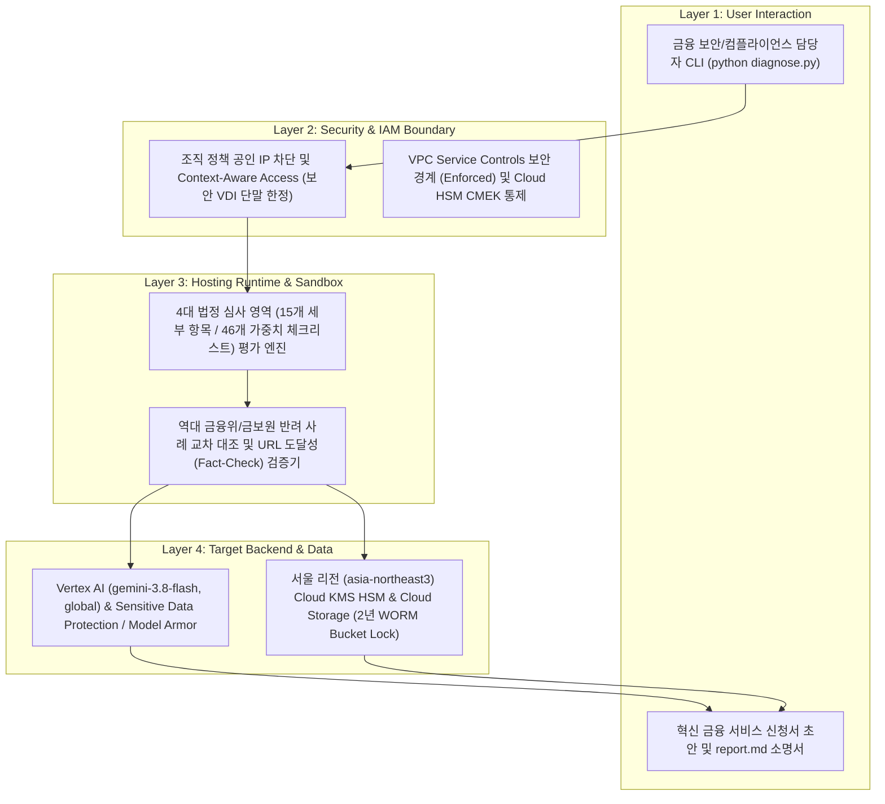

<!--
Copyright 2026 Google LLC. All Rights Reserved.
SPDX-License-Identifier: Apache-2.0
-->

# 금융위원회 혁신 금융 서비스(생성형 AI 망 분리 샌드박스) 사전 심사 및 반려 예방 도구

사내 생성형 AI 및 클라우드 SaaS 도입을 위해 금융위원회 혁신 금융 서비스(규제 샌드박스) 지정을 신청할 때, 4대 법정 심사 영역(15개 세부 카테고리, 46개 가중치 체크리스트)의 충족도를 사전 점수화하고 역대 반려 사례 대조 및 서울 리전(`asia-northeast3`) 참조 아키텍처 블루프린트를 자동 생성하는 진단 도구다. (As of 2026-11-14)

---

## 1. 발생 증상 및 진단 대상 체크리스트

* [ ] 생성형 AI 활용을 위해 전자금융감독규정 제15조(망 분리) 규제 특례를 신청하려 하나, **금융 소비자 편익, 규제 특례 필요성, 서비스 혁신성, 기술/보안 및 논리적 망 분리** 등 4대 심사 영역 중 어느 항목에서 보완 요구가 발생하는지 사전 가늠하기 어렵다.
* [ ] 신청서 초안에 내부 업무 효율성만 기재하고 **정량적 소비자 편익 수치**, **배상 책임 보험(사고당 10억 원/연간 20억 원 이상)**, **실증 한도 서킷 브레이커(Circuit Breaker)**, **만료 30일 전 출구 전략(Exit Plan)** 등 필수 법정 요건을 누락할 위험이 있다.
* [ ] 금융보안원 보안성 심의에서 빈번하게 반려되는 **VPC Service Controls(Dry-run 방치)**, **공인 IP 경유 API 호출**, **CMEK 미적용(GMEK 의존)**, **감사 로그 2년 불변 잠금(Bucket Lock WORM) 누락**을 제출 전에 일괄 점검하고 소명용 참조 아키텍처 블루프린트를 확보해야 한다.

---

## 2. 빠른 시작 (Quickstart)

### 1단계: 가상 실행 (Dry-Run)
GCP 과금이나 클라우드 권한 변경 없이 모의 데이터 기반으로 4대 심사 영역 점수표, 역대 반려 사례 매칭, 서울 리전 참조 블루프린트 및 `report.md` 산출물을 5초 만에 검증한다.

```bash
python diagnose.py --dry-run
```

### 2단계: 대화형 환경 설정 (선택 사항)
사내 GCP 프로젝트 ID와 신청서 초안 경로를 감지하여 `.env` 파일로 저장한다.

```bash
python diagnose.py --config
```

### 3단계: 실환경 및 신청서 정밀 진단 실행
활성 프로젝트 설정과 `.env` 구성을 바탕으로 실시간 진단을 수행하고 `report.md`를 갱신한다.

```bash
python diagnose.py
```

#### 터미널 출력 미리보기 (Terminal Preview)
```text
====================================================================================
[금융위원회 혁신 금융 서비스(생성형 AI 망 분리 샌드박스) 사전 심사 및 반려 예방 진단]
====================================================================================
 - 대상 프로젝트 ID : sample-project-id
 - 금융 인프라 리전 : asia-northeast3 (대한민국 서울 리전)
 - Gemini 모델/리전 : gemini-3.8-flash / global
 - 심사 영역 필터   : all
 - 실행 모드        : DRY-RUN (가상 시뮬레이션)
------------------------------------------------------------------------------------
[1/4] 금융위원회 4대 심사 영역(15개 세부 항목, 46개 체크리스트) 정합성 분석 중...
[2/4] 역대 혁신 금융 서비스 불승인/보완 요구 사례(75건 DB) 교차 대조 중...
  [PASS]         consumer_benefit.1 정량화된 소비자 편익 증대 증명 (9/9점)
  [WARN]         consumer_benefit.2 금융 사고 배상 책임 및 보상 체계 마련 (5/8점)
  [REJECT_RISK]  regulatory_necessity.2 금융 시장 리스크 방지를 위한 실증 한도 설정 (3/8점)
  [REJECT_RISK]  technical_security.3 데이터 유출 방지 및 가상 보안 경계 설정 (3/9점)
  [REJECT_RISK]  technical_security.6 보안 관제 및 실시간 감사 로깅 위변조 방지 (3/9점)
------------------------------------------------------------------------------------
[진단 요약] 총점: 98/121점 (81.0%) | 반려 위험(REJECT_RISK): 3건 | 보완 권고(WARN): 2건
[산출물] 상세 심사 소명서 및 아키텍처 블루프린트가 저장되었다: report.md
====================================================================================
```

---

## 3. 솔루션 아키텍처 및 처리 흐름



---

## 4. 조치 가이드 및 권장 설정

금융보안원 물적 설비 심사에서 반려 빈도가 가장 높은 **서울 리전(`asia-northeast3`) Cloud HSM 기반 CMEK 키 통제**, **감사 로그 2년 불변 보존(WORM Bucket Lock)**, **실증 한도 서킷 브레이커 알림 토픽**을 4대 필수 라벨과 함께 즉시 구성하는 명령어다.

```bash
# 1. 서울 리전(asia-northeast3) Cloud HSM 기반 고객 관리 암호화 키(CMEK) 생성
gcloud kms keyrings create fsc-sandbox-keyring \
  --location=asia-northeast3 \
  --project=YOUR_PROJECT_ID

gcloud kms keys create fsc-ai-cmek-key \
  --keyring=fsc-sandbox-keyring \
  --location=asia-northeast3 \
  --purpose=encryption \
  --protection-level=hsm \
  --rotation-period=90d \
  --next-rotation-time=$(date -u -d '+90 days' +%Y-%m-%dT%H:%M:%SZ) \
  --labels=managed-by=google-cloud-0-to-1,scenario=korea-fsc-sandbox-helper,env=sample,created-by=customer-engineer \
  --project=YOUR_PROJECT_ID

# 2. 감사 로그 및 AI 프롬프트 이력 2년(730일) 불변 보존(WORM Bucket Lock) 버킷 생성
gcloud storage buckets create gs://YOUR_PROJECT_ID-fsc-audit-worm \
  --location=asia-northeast3 \
  --uniform-bucket-level-access \
  --public-access-prevention \
  --retention-period=730d \
  --default-encryption-key=projects/YOUR_PROJECT_ID/locations/asia-northeast3/keyRings/fsc-sandbox-keyring/cryptoKeys/fsc-ai-cmek-key \
  --labels=managed-by=google-cloud-0-to-1,scenario=korea-fsc-sandbox-helper,env=sample,created-by=customer-engineer \
  --project=YOUR_PROJECT_ID

# 3. 실증 한도(Cap) 90% 도달 및 서킷 브레이커 발동 경보용 Pub/Sub 토픽 생성
gcloud pubsub topics create fsc-sandbox-circuit-breaker-alerts \
  --labels=managed-by=google-cloud-0-to-1,scenario=korea-fsc-sandbox-helper,env=sample,created-by=customer-engineer \
  --project=YOUR_PROJECT_ID
```

---

## 5. 사전 준비 사항 (필요 IAM 권한)

실환경 점검 및 Gemini 참조 아키텍처 블루프린트 생성을 위해 필요한 최소 권한(Least Privilege) 명세다.

| 대상 서비스 | 필요 IAM 역할 (Role) | 주요 확인 및 호출 API 권한 |
| :--- | :--- | :--- |
| **Cloud KMS** | `roles/cloudkms.viewer` | `cloudkms.keyRings.list`, `cloudkms.cryptoKeys.list` (CMEK 및 HSM 적용 확인) |
| **Cloud Storage** | `roles/storage.legacyBucketReader` | `storage.buckets.list`, `storage.buckets.get` (Bucket Lock 2년 보존 정책 확인) |
| **Vertex AI** | `roles/aiplatform.user` | `aiplatform.endpoints.predict` (`gemini-3.8-flash` 기반 참조 아키텍처 블루프린트 생성) |

---

## 6. 기술적 배경 및 아키텍처 원리 (Deep Dive)

### 핵심 설계 원칙 (Core Design Rationale)
금융혁신지원 특별법 제13조 및 전자금융감독규정 제15조(망 분리 예외) 심사는 단순 클라우드 기능 나열이 아니라 **정량적 소비자 보호(배상 책임 보험 및 선보상)**, **리스크 통제(실증 한도 서킷 브레이커 및 30일 전 출구 전략)**, **논리적 망 분리 대체 통제(PSC 비공개 통신, VPC-SC Enforced, Cloud HSM CMEK, 2년 WORM 감사 로그)**의 3축이 완결되어야 통과된다. 본 도구는 15개 세부 심사 기준과 역대 반려 사례를 교차 검증하고, 신청서 내 참조 URL의 HTTP 도달성까지 자동 확인하여 서류 반려 및 보안 심의 지연을 예방한다.

* **관련 공식 가이드**:
  * 금융규제 샌드박스 공식 포털 ( https://sandbox.fsc.or.kr )
  * 금융보안원 클라우드 및 생성형 AI 보안 가이드 ( https://www.fsec.or.kr )
  * VPC Service Controls 보안 경계 개요 ( https://cloud.google.com/vpc-service-controls/docs/overview )
  * Cloud KMS 고객 관리 암호화 키(CMEK) 문서 ( https://cloud.google.com/kms/docs/cmek )
  * Cloud Storage Bucket Lock (WORM) 문서 ( https://cloud.google.com/storage/docs/bucket-lock )

---

## 7. 리소스 정리 (Teardown) 안내

진단 및 테스트 목적으로 생성한 로컬 산출물과 샘플 클라우드 리소스를 정리하려면 아래 명령어를 실행한다.

```bash
# 1. 로컬 환경 설정 파일 정리
rm -f .env

# 2. 테스트용으로 생성한 Pub/Sub 토픽 및 불변 버킷 삭제 (Retention Lock 확정 전)
gcloud pubsub topics delete fsc-sandbox-circuit-breaker-alerts \
  --project=YOUR_PROJECT_ID --quiet

gcloud storage buckets delete gs://YOUR_PROJECT_ID-fsc-audit-worm \
  --project=YOUR_PROJECT_ID --quiet
```
