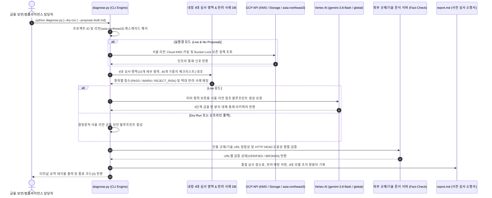

<!--
Copyright 2026 Google LLC. All Rights Reserved.
SPDX-License-Identifier: Apache-2.0

NOTICE: This code/repository is owned by Google LLC and provided under the Apache-2.0 License.
It is strictly provided as an EXAMPLE/REFERENCE ONLY and is NOT INTENDED FOR PRODUCTION USE.
All contents, designs, and code examples are subject to change, modification, or removal at any time without notice.

[고지 사항] 본 저장소 및 문서는 구글 (Google LLC) 소유이며 Apache 2.0 라이선스 하에 예시 (Sample) 용도로 제공된다.
프로덕션 환경용이 아니며, 사전 통지 없이 언제든지 수정, 변경 또는 삭제될 수 있다.
-->

> [!IMPORTANT]
> **구글 (Google LLC) 참조용 샘플 고지 사항**:
> 본 프로젝트의 모든 소스 코드와 문서는 Google LLC의 소유이며, Apache-2.0 라이선스에 따라 오직 **참조용 샘플 (Sample / Reference Only)** 목적으로만 제공된다. 프로덕션 환경에 그대로 사용할 수 없으며, 사전 통지 없이 언제든 내용이 수정, 변경 또는 삭제될 수 있다.

# 기술 상세 설계서 (TDD): 금융위원회 혁신 금융 서비스(생성형 AI 망 분리 샌드박스) 사전 심사 도구 (korea-fsc-sandbox-helper)

## 1. 시스템 런타임 상호작용 시퀀스 (End-to-End Sequence)

## 2. 기능적 요구 사항 (Functional Requirements)

| ID | 구현 모듈 및 함수 | 상세 기술 명세 | 추적 BRD |
| :---: | :--- | :--- | :---: |
| **FR-01** | `AUDIT_CHECKLIST_DB` | 4대 대분류 / 15개 중분류 / **46개 소분류(`category:sub_id:item_id`, 총 가중치 102점)** 및 소분류별 법정 기준(`desc`), 신청서 즉시 삽입용 모범 보완 문구(`remedy_clause`) 내장 | BR-01, BR-02, BR-03, BR-04 |
| **FR-02** | `REJECTION_CASES_DB` | 금융위원회, 금융감독원, 금융보안원 역대 반려 및 보완 요구 대표 사례를 세부 항목 키(`category`, `sub_id`)와 1:1 매핑 | BR-05 |
| **FR-03** | `evaluate_sandbox_readiness()` | 제출된 신청서(`.pdf`, `.md`, `.txt` 또는 내장 초기 제출서 `SAMPLE_DRAFT_APPLICATION`)와 46개 소분류를 1:1 대조하여 소분류별 `PASS` / `GAP` 판정, 감점 사유 및 100점 환산 점수를 도출하고, `--simulate-item` 자가 보완 시뮬레이터(`simulate_remedy_clause()`)를 지원 | BR-01 ~ BR-05 |
| **FR-04** | `generate_reference_blueprint()` | `google-genai` SDK를 통해 `gemini-3.8-flash`(`location="global"`)를 호출하여 서울 리전(`asia-northeast3`) 참조 아키텍처 생성 및 오프라인 결정론적 폴백 보장 | BR-06 |
| **FR-05** | `verify_reference_urls()` | `ThreadPoolExecutor` 기반으로 신청서 내 공식 레퍼런스 URL의 형식 및 HTTP HEAD 응답 코드를 병렬 검증 | BR-06 |
| **FR-06** | `render_report_markdown()` | 4대 심사 영역 점수표, 반려 사례 대조표, 참조 블루프린트, URL Fact-Check 표, 4대 필수 라벨이 적용된 `gcloud` 조치 스크립트를 `report.md`로 출력 | BR-07, BR-08 |
| **FR-07** | `resolve_project_id()` & `run_config_wizard()` | CLI 인자 > `.env` > `gcloud config` > 대화형 번호 선택기 > 기본값(`sample-project-id`) 5단계 캐스케이드 탐지 및 `--config` 마법사 제공 | BR-07 |

## 3. 비기능적 요구 사항 (Non-Functional Requirements)

| ID | 구분 | 상세 기준 |
| :---: | :--- | :--- |
| **NFR-01** | 자체 완결성 및 무의존성 | 외부 FastAPI 웹 서버나 서드파티 LLM SDK 없이 단일 `diagnose.py` 스크립트로 Linux, macOS, Windows에서 동일하게 실행된다. |
| **NFR-02** | 실행 속도 및 타임아웃 방어 | `--dry-run` 실행 시 2초 이내에 완료되며, 외부 `gcloud` 및 HTTP 호출에는 5~12초 타임아웃을 강제하여 행(Hang)을 방지한다. |
| **NFR-03** | 데이터 주권 및 보안 비식별화 | 모든 기본 인프라 리전은 `asia-northeast3`로 고정하며, 가상 실행 시 가명(`sample-project-id`)을 사용하여 실환경 식별자 유출을 차단한다. |
| **NFR-04** | 에버그린 모델 표준 | Gemini 호출은 `gemini-3.8-flash` 및 `location="global"` 단일 표준을 준수한다. |
