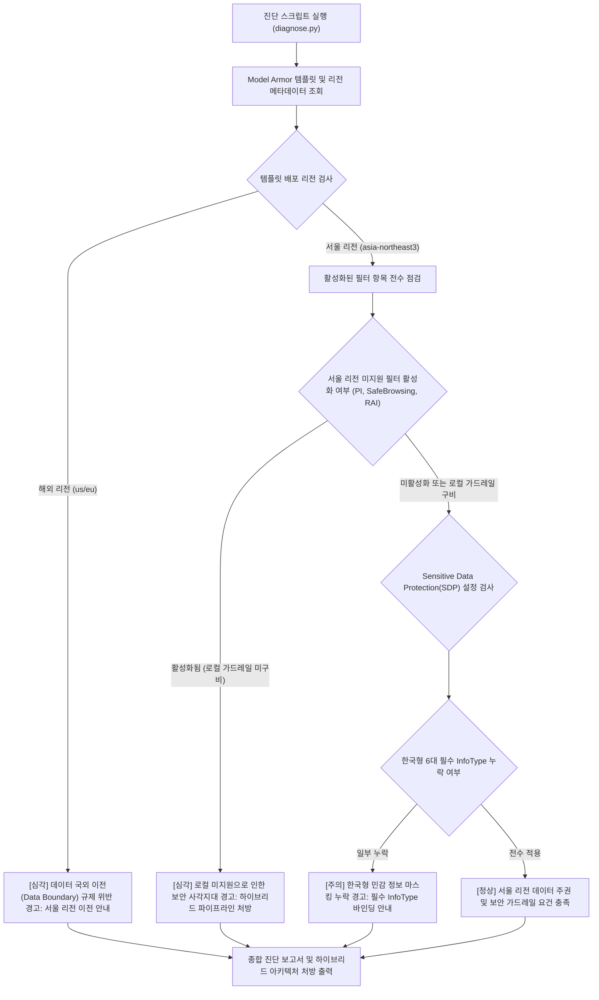

<!--
Copyright 2026 Google LLC. All Rights Reserved.
SPDX-License-Identifier: Apache-2.0

NOTICE: This code/repository is owned by Google LLC and provided under the Apache-2.0 License.
It is strictly provided as an EXAMPLE/REFERENCE ONLY and is NOT INTENDED FOR PRODUCTION USE.
All contents, designs, and code examples are subject to change, modification, or removal at any time without notice.

[고지 사항] 본 저장소 및 문서는 구글 (Google LLC) 소유이며 Apache 2.0 라이선스 하에 예시 (Sample) 용도로 제공된다.
프로덕션 환경용이 아니며, 사전 통지 없이 언제든지 수정, 변경 또는 삭제될 수 있다.
-->

> [!IMPORTANT]
> **구글 (Google LLC) 참조용 샘플 고지 사항**:
> 본 프로젝트의 모든 소스 코드와 문서는 Google LLC의 소유이며, Apache-2.0 라이선스에 따라 오직 **참조용 샘플 (Sample / Reference Only)** 목적으로만 제공된다. 프로덕션 환경에 그대로 사용할 수 없으며, 사전 통지 없이 언제든 내용이 수정, 변경 또는 삭제될 수 있다.

# 서울 리전 Model Armor 기능 제약 및 한국형 가드레일 하이브리드 보완 진단기 (korea-model-armor-guard)

대한민국 서울 리전(asia-northeast3) 환경에서 Model Armor 템플릿의 리전 미지원 필터(프롬프트 인젝션, 악성 URL, RAI)로 인한 보안 사각지대와 데이터 국외 이전 규제 위반 위험을 1분 만에 자동 진단하고, 한국형 개인 정보(Korea-specific InfoTypes) 및 로컬 하이브리드 가드레일 파이프라인 처방을 제공하는 도구다. (As of 2026-10-17)

---

## 1. 발생 증상 및 진단 대상 체크리스트

사내 또는 고객사 환경에서 아래 증상이 발생한다면 즉시 진단 대상이다:
- [ ] 금융감독원 '혁신 금융 서비스 지정' 또는 국내 개인 정보 보호법 준수를 위해 생성형 AI 데이터 처리를 서울 리전(`asia-northeast3`) 내에서만 완결해야 한다.
- [ ] Model Armor 콘솔에서 프롬프트 인젝션(Prompt Injection) 및 악성 URL 차단 필터를 활성화했으나, 서울 리전 로컬 엔진 부재로 인해 실제 검사가 바이패스되거나 해외 리전으로 데이터가 유출될 위험이 존재한다.
- [ ] 서울 리전에서 Model Armor가 Sensitive Data Protection(SDP)만 정식 지원하므로, 인젝션 방어 및 안전성 필터 동작을 위해 별도의 로컬 가드레일 계층을 수립하여 보완해야 하는 경우다.
- [ ] SDP 템플릿 설정 시 주민등록번호(`KOREA_RRN`), 여권번호(`KOREA_PASSPORT`), 운전면허번호, 외국인등록번호, 사업자등록번호 등 한국 전용 민감 정보(Korea-specific InfoTypes)가 누락되어 비식별화 처리가 누락된다.

---

## 2. 빠른 시작 (Quickstart)

### 1) 모의 데이터 가상 실행 (Dry-Run)
GCP API 호출 없이 내장된 가상 인프라 데이터로 정상 동작 여부를 즉시 검증한다:
```bash
python diagnose.py --dry-run
```

**터미널 진단 출력 미리보기:**
```text
Model Armor 서울 리전 규제 준수 정합성 진단 시작 (프로젝트: sample-project-id, 리전: asia-northeast3)
--> 가상 실행 모드 (--dry-run) 활성화: 사전 시뮬레이션 Model Armor 템플릿 데이터를 분석한다.
=========================================================================================================
템플릿 이름                           리전                 인포타입 수       프롬프트인젝션            심각도       
---------------------------------------------------------------------------------------------------------
ma-template-seoul-finance        asia-northeast3    3            ENABLED (지원불가)     CRITICAL  
ma-template-global-uncompliant   us-central1        6            ENABLED            CRITICAL  
ma-template-hybrid-hardened      asia-northeast3    6            DISABLED           HEALTHY   
=========================================================================================================
[발견된 주요 컴플라이언스 결함 및 처방 조치]
```

### 2) 실제 사내 인프라 실시간 진단
```bash
cp .env.example .env
python diagnose.py
```
> [!NOTE]
> `.env` 설정값을 비워두면 gcloud 활성 설정 및 사내 리소스를 자동으로 감지하여 진단한다.

---

## 3. 진단 및 해결 흐름



---
## 4. 조치 가이드 및 권장 설정

- Model Armor 제품 개요 및 리전 가용성 안내 ( https://cloud.google.com/security/products/model-armor )
- Model Armor 템플릿 구성 공식 가이드 ( https://docs.cloud.google.com/model-armor/overview )
- Sensitive Data Protection 글로벌 및 로컬 리전 위치 ( https://cloud.google.com/sensitive-data-protection/docs/locations )

### 1. Model Armor 서울 리전 SDP 전용 템플릿 생성
```bash
gcloud beta model-armor templates create ma-template-seoul-hardened \
    --location=asia-northeast3 \
    --filter-config="sdpSettings={inspectTemplate='projects/[PROJECT_ID]/locations/asia-northeast3/inspectTemplates/korea-pii-template'}"
```

### 2. 한국 전용 6대 민감정보(Korea InfoTypes) SDP 템플릿 생성
```bash
gcloud dlp inspect-templates create \
    --location=asia-northeast3 \
    --display-name="korea-pii-template" \
    --info-types=KOREA_RRN,KOREA_PASSPORT,KOREA_DRIVERS_LICENSE_NUMBER,KOREA_ARN,KOREA_BRN,KOREA_NHI_NUMBER
```

### 3. 하이브리드 로컬 가드레일(On-soil Sanitization) 권고 아키텍처
서울 리전의 Model Armor가 지원하지 않는 프롬프트 인젝션 및 악성 URL 검사는 애플리케이션 수신단에서 로컬 경량 검사 엔진을 1차 통과시킨 후, Model Armor의 서울 SDP 엔드포인트를 호출하는 투트랙(Two-track) 방어선을 구축한다.

사내 Python 애플리케이션에 직접 임베딩할 수 있는 서울 리전 온소일(On-soil) 1차 프롬프트 살균 예시:
```python
import re

# 대한민국 고유 민감 정보 및 프롬프트 인젝션 로컬 검증 패턴 (On-soil Regex)
KOREA_LOCAL_FILTERS = {
    "RRN": re.compile(r"\b\d{2}(?:0[1-9]|1[0-2])(?:0[1-9]|[12]\d|3[01])-[1-8]\d{6}\b"),
    "PHONE": re.compile(r"\b01[016789]-(?:\d{3}|\d{4})-\d{4}\b"),
    "INJECTION": re.compile(r"(?i)(ignore previous instructions|system prompt|jailbreak|탈옥|이전 지시 무시)"),
}

def sanitize_on_soil(prompt: str) -> tuple[str, bool]:
    has_violation = False
    if KOREA_LOCAL_FILTERS["INJECTION"].search(prompt):
        return "[BLOCKED_BY_ON_SOIL_GUARD]", True
    sanitized = prompt
    for name, pattern in KOREA_LOCAL_FILTERS.items():
        if name != "INJECTION" and pattern.search(sanitized):
            has_violation = True
            sanitized = pattern.sub(f"[{name}_MASKED]", sanitized)
    return sanitized, has_violation
```

---
## 5. 사전 준비 사항 (필요 IAM 권한)

본 도구를 실행하려면 최소 아래의 IAM 권한이 필요하다:

| 역할 (Role) | 설명 |
| : | : |
| `Model Armor 뷰어(roles/modelarmor.viewer)` | Model Armor 템플릿 읽기 권한 (`modelarmor.templates.get`, `modelarmor.templates.list`) |
| `DLP 리더(roles/dlp.reader)` | Sensitive Data Protection 검사 템플릿 조회 권한 (`dlp.inspectTemplates.get`) |

---

## 6. 기술적 배경 및 아키텍처 원리 (Deep Dive)

### 관련 상세 설계 및 요구 사항 명세
- [비즈니스 요구 사항 명세서 (BRD)](docs/BRD.md): 비즈니스 배경, 성공 지표 및 요구 사항(BR-01~) 명세
- [기술 상세 설계서 (TDD)](docs/TDD.md): 시스템 아키텍처, 기능(FR-01~) 및 비기능(NFR-01~) 설계 명세

Model Armor 템플릿 및 Sensitive Data Protection 템플릿 배포 시 다음 4대 표준 라벨을 반드시 적용한다:
- `managed-by`: `google-cloud-0-to-1`
- `scenario`: `korea-model-armor-guard`
- `env`: `sample` (또는 `poc`)
- `created-by`: `customer-engineer`

---
## 7. 리소스 정리 (Teardown) 안내

본 도구는 읽기 전용 진단 스크립트이므로 자체적으로 리소스를 생성하지 않는다. 테스트 목적으로 생성한 Model Armor 템플릿이나 DLP 템플릿은 다음 명령어로 삭제한다:
```bash
gcloud beta model-armor templates delete [TEMPLATE_NAME] --location=asia-northeast3 --quiet
gcloud dlp inspect-templates delete [DLP_TEMPLATE_NAME] --location=asia-northeast3 --quiet
```
