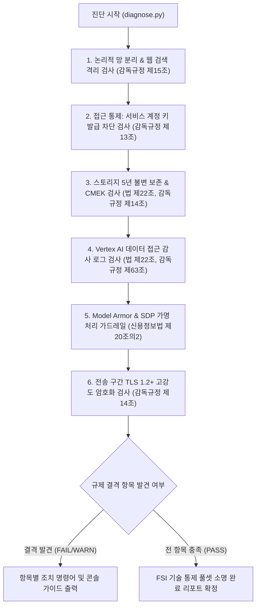

<!--
Copyright 2026 Google LLC. All Rights Reserved.
SPDX-License-Identifier: Apache-2.0

NOTICE: This code/repository is owned by Google LLC and provided under the Apache-2.0 License.
It is strictly provided as an EXAMPLE/REFERENCE ONLY and is NOT INTENDED FOR PRODUCTION USE.
All contents, designs, and code examples are subject to change, modification, or removal at any time without notice.

[고지 사항] 본 저장소 및 문서는 구글 (Google LLC) 소유이며 Apache 2.0 라이선스 하에 예시 (Sample) 용도로 제공된다.
프로덕션 환경용이 아니며, 사전 통지 없이 언제든지 수정, 변경 또는 삭제될 수 있다.
-->

> [!IMPORTANT]
> **구글 (Google LLC) 참조용 샘플 고지 사항**:
> 본 프로젝트의 모든 소스 코드와 문서는 Google LLC의 소유이며, Apache-2.0 라이선스에 따라 오직 **참조용 샘플 (Sample / Reference Only)** 목적으로만 제공된다. 프로덕션 환경에 그대로 사용할 수 없으며, 사전 통지 없이 언제든 내용이 수정, 변경 또는 삭제될 수 있다.

# 혁신 금융 서비스 규제 준수 보안 경계 진단 가이드 (korea-regulatory-perimeter-guard)

대한민국 금융위원회의 「금융 분야 망 분리 개선 로드맵」(1단계 생성형 AI 활용 특례) 및 전자금융감독규정에 따라, 퍼블릭 클라우드 인프라가 책임져야 하는 **9대 핵심 기술적 통제(Technical Controls) 전수(Full-Set)**를 체계적으로 종합 점검하고 금융감독원 및 금융보안원(FSI) 보안성 심의 결격 사유를 사전에 예방하는 진단 도구다. (As of 2026-10-17)

---

## 1. 발생 증상 및 진단 대상 체크리스트

사내 또는 고객사 환경에서 아래 증상이 발생한다면 즉시 진단 대상이다:
- [ ] 관련 인프라 및 서비스 이상 징후 발생 시 즉시 진단 대상

---

## 2. 빠른 시작 (Quickstart)

### 1) 모의 데이터 가상 실행 (Dry-Run)
GCP API 호출 없이 내장된 가상 인프라 데이터로 정상 동작 여부를 즉시 검증한다:
```bash
python diagnose.py --dry-run
```

**터미널 진단 출력 미리보기:**
```text
- 조치 권고: 외부 검색 연동 워크로드를 VPC-SC 외부 DMZ 프로젝트로 이관하고 내부 인스턴스로의 비동기 적재 파이프라인 구성 권장
FR-03        | 데이터 보호         | [FAIL] | Cloud Storage 불변 보존(Retention Policy / Bucket Lock) 5년 충족 여부 (법 제22조)
  - 현재 상태: 지정 버킷에 보존 정책 미설정 (retention_period: 0s)
  - 규제 요건: 전자금융거래법 제22조 및 전자금융감독규정 제63조에 따라 감사 로그 및 AI 입출력 저장 버킷은 최소 5년(157,680,000초) 보존 및 잠금(Bucket Lock) 필수
  - 조치 권고: gcloud storage buckets update gs://sample-project-id-audit-logs --retention-period=157680000s && gcloud storage buckets lock gs://sample-project-id-audit-logs
FR-04        | 데이터 보호         | [PASS] | 고객 관리 암호화 키(CMEK) 전면 적용 여부 (감독규정 제14조)
  - 현재 상태: Cloud KMS 키(projects/sample-project-id/locations/asia-northeast3/keyRings/fsi-ring/cryptoKeys/cmek-key) 정상 바인딩 확인
FR-05        | 감사 추적          | [FAIL] | 데이터 접근 감사 로그(DATA_READ, DATA_WRITE) 활성화 여부 (법 제22조)
  - 현재 상태: aiplatform.googleapis.com 데이터 접근 로그 미설정 (ADMIN_READ 만 활성화됨)
  - 규제 요건: 전자금융거래법 제22조 및 전자금융감독규정 제14조에 따라 금융 거래 및 AI 추론 데이터 조회를 위해 DATA_READ, DATA_WRITE 로그 감사 필수 수집
```

### 2) 실제 사내 인프라 실시간 진단
```bash
cp .env.example .env
python diagnose.py
```
> [!NOTE]
> `.env` 설정값을 비워두면 gcloud 활성 설정 및 사내 리소스를 자동으로 감지하여 진단한다.

---

## 3. 진단 및 해결 흐름



---
## 4. 조치 가이드 및 권장 설정

1. **서비스 계정 키 생성 차단 (전자금융감독규정 제13조)**:
   - 정적 서비스 계정 JSON 키 발급을 방지하고 WIF 연동을 강제한다.
   ```bash
   gcloud resource-manager org-policies enable-enforce constraints/iam.disableServiceAccountKeyCreation --project=$PROJECT_ID
   ```

2. **전송 구간 암호화 정책 수립 (전자금융감독규정 제14조)**:
   - 취약한 프로토콜(TLS 1.0, 1.1)을 차단하고 TLS 1.2 이상만 허용하는 커스텀 SSL 정책을 생성한다.
   ```bash
   gcloud compute ssl-policies create fsi-tls-policy --profile=RESTRICTED --min-tls-version=1.2 --project=$PROJECT_ID
   ```

3. **Cloud Storage 5년 보존 정책 및 Bucket Lock 적용 (전자금융거래법 제22조 및 전자금융감독규정 제63조)**:
   - 금융 감사 로그 및 AI 입출력 버킷에 5년(157,680,000초) 불변 보존을 강제한다.
   ```bash
   gcloud storage buckets update gs://<AUDIT_BUCKET_NAME> --retention-period=157680000s
   gcloud storage buckets lock gs://<AUDIT_BUCKET_NAME>
   ```

4. **Vertex AI 데이터 접근 감사 로그 강제 (전자금융감독규정 제14조 및 제63조)**:
   - 프로젝트 IAM 정책에 `aiplatform.googleapis.com` 및 `storage.googleapis.com` 데이터 접근 로그(`DATA_READ`, `DATA_WRITE`)를 추가한다.

5. **Model Armor 및 Sensitive Data Protection(SDP) 가드레일 연동 (신용정보법 제20조의2)**:
   - 악성 프롬프트 인젝션 방어 필터를 활성화하고 주민등록번호(`KOREA_RESIDENT_REGISTRATION_NUMBER`) 가명 처리 템플릿을 등록한다.

---
## 5. 사전 준비 사항 (필요 IAM 권한)

본 도구를 실행하려면 최소 아래의 IAM 권한이 필요하다:

본 도구 구동을 위해 필요한 최소 IAM 권한은 다음과 같다.

| 권한 역할 | 역할 명칭 | 필요 사유 |
| : | : | : |
| `roles/accesscontextmanager.reader` | `Access Context Manager 독자(roles/accesscontextmanager.reader)` | VPC-SC 서비스 보안 경계 설정 조회 (감독규정 제15조) |
| `roles/compute.viewer` | `Compute 뷰어(roles/compute.viewer)` | SSL 정책 TLS 최소 버전 조회 (감독규정 제14조) |
| `roles/dlp.inspectTemplatesReader` | `DLP 검사 템플릿 독자(roles/dlp.inspectTemplatesReader)` | Sensitive Data Protection 가명 처리 템플릿 조회 (신용정보법 제20조의2) |
| `roles/logging.viewer` | `클라우드 로깅 뷰어(roles/logging.viewer)` | 프로젝트 IAM 감사 로그(auditConfigs) 설정 조회 (법 제22조) |
| `roles/orgpolicy.policyViewer` | `조직 정책 뷰어(roles/orgpolicy.policyViewer)` | 서비스 계정 키 생성 차단 조직 정책 조회 (감독규정 제13조) |
| `roles/storage.admin` | `스토리지 관리자(roles/storage.admin)` | Cloud Storage 버킷 보존 정책 및 잠금 상태 조회 (5년 보존 규정) |

---

## 6. 기술적 배경 및 아키텍처 원리 (Deep Dive)

### 관련 상세 설계 및 요구 사항 명세
- [비즈니스 요구 사항 명세서 (BRD)](docs/BRD.md): 비즈니스 배경, 성공 지표 및 요구 사항(BR-01~) 명세
- [기술 상세 설계서 (TDD)](docs/TDD.md): 시스템 아키텍처, 기능(FR-01~) 및 비기능(NFR-01~) 설계 명세

```text
========================================================================================
 혁신 금융 서비스(FSI) 규제 준수 보안 경계 진단 리포트
 대상 프로젝트: example-fsi-corp | 점검 리전: asia-northeast3 | 실행 모드: 가상 진단 (Dry-Run)
========================================================================================

진단 요약: 총 9개 규제 항목 중 충족 4건, 주의 2건, 미달 3건
----------------------------------------------------------------------------------------
ID      | 분류             | 상태     | 진단 항목 및 조치 요약
----------------------------------------------------------------------------------------
FR-01   | 논리적 망 분리        | [PASS] | VPC-SC 보안 경계 내 Vertex AI 보호 확인
FR-02   | 논리적 망 분리        | [WARN] | 실시간 웹 검색 DMZ 분리 및 비동기 적재 구조 권고
FR-03   | 데이터 보호         | [FAIL] | Cloud Storage 5년 불변 보존(Bucket Lock) 미설정 (법 제22조)
FR-04   | 데이터 보호         | [PASS] | 고객 관리 암호화 키(CMEK) 전면 바인딩 확인 (감독규정 제14조)
FR-05   | 감사 추적          | [FAIL] | Vertex AI 데이터 접근 감사 로그(DATA_READ/WRITE) 미설정
FR-06   | AI 모델 거버넌스     | [PASS] | Model Armor 프롬프트 인젝션 방어 필터 적용 확인
FR-07   | AI 모델 거버넌스     | [WARN] | SDP 주민등록번호/계좌번호 특화 가명 처리 템플릿 등록 권고
FR-08   | 접근 통제          | [FAIL] | 서비스 계정 키 생성 차단 조직 정책 미적용 (감독규정 제13조)
FR-09   | 전송 보안          | [PASS] | 전송 구간 TLS 1.2+ 고강도 암호화 적용 확인 (감독규정 제14조)
----------------------------------------------------------------------------------------
종합 평가: 금융보안원 보안성 심의 전 미달(FAIL) 3건의 우선 조치가 요구된다.
========================================================================================
```

---
## 7. 리소스 정리 (Teardown) 안내

본 도구는 순수 진단 및 상태 점검을 수행하므로 자체적으로 영구 리소스를 생성하거나 과금을 유발하지 않는다.
진단 과정에서 테스트용으로 생성한 모의 버킷이나 키가 있는 경우 아래 명령어로 정리한다.

```bash
# 테스트용 버킷 삭제 (잠금되지 않은 버킷에 한함)
gcloud storage rm -r gs://<TEST_BUCKET_NAME>
```

---
