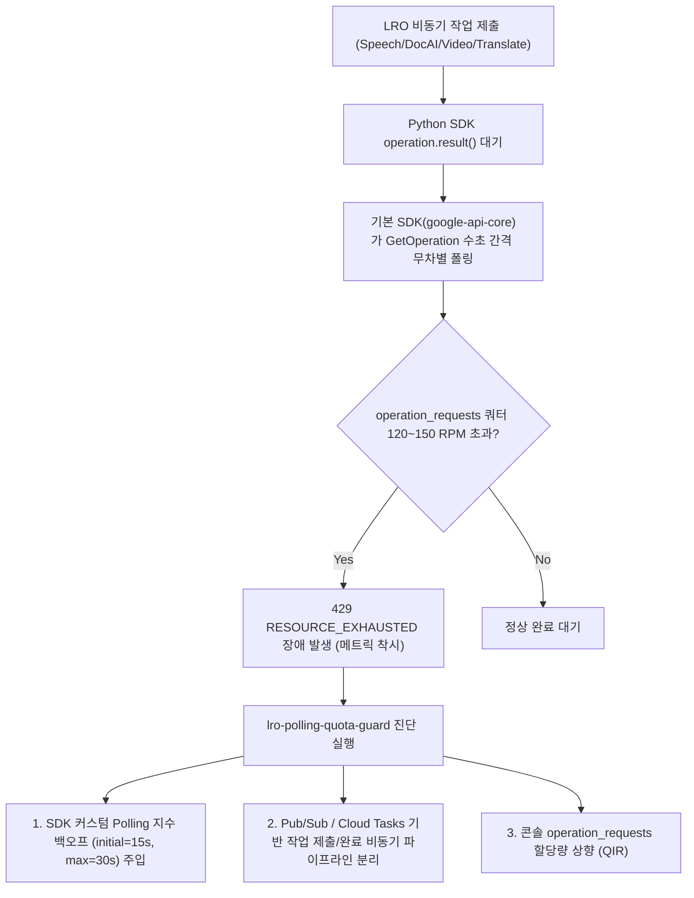

<!--
Copyright 2026 Google LLC. All Rights Reserved.
SPDX-License-Identifier: Apache-2.0

NOTICE: This code/repository is owned by Google LLC and provided under the Apache-2.0 License.
It is strictly provided as an EXAMPLE/REFERENCE ONLY and is NOT INTENDED FOR PRODUCTION USE.
All contents, designs, and code examples are subject to change, modification, or removal at any time without notice.

[고지 사항] 본 저장소 및 문서는 구글 (Google LLC) 소유이며 Apache 2.0 라이선스 하에 예시 (Sample) 용도로 제공된다.
프로덕션 환경용이 아니며, 사전 통지 없이 언제든지 수정, 변경 또는 삭제될 수 있다.
-->

> [!IMPORTANT]
> **구글 (Google LLC) 참조용 샘플 고지 사항**:
> 본 프로젝트의 모든 소스 코드와 문서는 Google LLC의 소유이며, Apache-2.0 라이선스에 따라 오직 **참조용 샘플 (Sample / Reference Only)** 목적으로만 제공된다. 프로덕션 환경에 그대로 사용할 수 없으며, 사전 통지 없이 언제든 내용이 수정, 변경 또는 삭제될 수 있다.

# Google Cloud LRO 비동기 작업 폴링 쿼터 고갈 및 429 장애 진단 도구 (lro-polling-quota-guard)

Google Cloud 비동기 장기 실행 작업(LRO, Long-Running Operations) 파이프라인에서 대시보드상 요청 RPM이 정상임에도 발생하는 원인 불명의 `429 RESOURCE_EXHAUSTED` 장애를 진단하고, Python SDK(`google-api-core`) 비동기 폴링 지수 백오프 최적화 및 비동기 분리 아키텍처를 처방하는 범용 진단 도구다. (As of 2026-10-17)

---

## 1. 발생 증상 및 진단 대상 체크리스트

사내 또는 고객사 환경에서 아래 증상이 발생한다면 즉시 진단 대상이다:
- [ ] Speech-to-Text V2 (`BatchRecognize`), Document AI (`BatchProcessDocuments`), Video Intelligence (`AnnotateVideo`), Translation V3 (`BatchTranslateDocument`) 등 대용량 비동기 배치 파이프라인에서 원인 모를 `429 RESOURCE_EXHAUSTED` 에러가 발생한다.
- [ ] Google Cloud 콘솔 할당량 대시보드에서 주 작업 요청 지표(예: `BatchRecognize requests`, `BatchProcess requests`)는 한도 대비 여유가 충분한데 서비스가 중단된다.
- [ ] 파이썬 코드에서 `operation = client.some_batch_method(...)` 실행 후 `operation.result()`로 동기 블로킹 대기하고 있다.
- [ ] 다수의 워커 스레드나 프로세스가 동시에 작업을 대기하면서 구글 클라이언트 SDK의 내부 폴링 주기로 인해 리전당 `operation_requests` 쿼터(기본 120~150 RPM)를 순식간에 초과하고 있다.

---

## 2. 빠른 시작 (Quickstart)

> [!TIP]
> Cloud Shell 접속 환경 구성 및 저장소 클론(`git clone`) 방법은 루트의 [메인 README](../../README.md)를 참고한다.

### 1) 모의 데이터 가상 실행 (Dry-Run)
GCP API 호출 없이 내장된 가상 인프라 데이터로 정상 동작 여부를 즉시 검증한다:
```bash
python diagnose.py --dry-run
```

**터미널 진단 출력 미리보기:**
```text
처방 2: 동기식 블로킹 대기 지양 및 비동기 큐 파이프라인 분리 (엔터프라이즈 권장)
  - 워커 프로세스에서 `operation.result()`로 동기 대기하지 않고, `operation.operation.name`을 Cloud Tasks나 Pub/Sub에 적재 후 즉시 반환한다.
  - 단일 스케줄러 워커가 1분 간격으로 대기열에 있는 작업들의 상태를 일괄 조회하여 쿼터 소진을 원천 제어한다.
처방 3: 콘솔을 통한 필수 할당량 상향 요청 (QIR)
  - 콘솔 경로: IAM & Admin > Quotas ( https://console.cloud.google.com/iam-admin/quotas?project=sample-project-id )
  - 대상 서비스: Cloud Speech-to-Text V2 (리전: us-central1)
  - 필수 상향 지표: `speech.googleapis.com/operation_requests` (기본 150 RPM -> 1,000+ RPM 권장)
========================================================================================
[안내] 복습 및 사내 공유용 진단 리포트가 생성(덮어쓰기)되었다: /usr/local/google/home/stanleychoi/Projects/google-cloud-0-to-1/samples/lro-polling-quota-guard/report.md
```

### 2) 실제 사내 인프라 실시간 진단
```bash
cp .env.example .env
python diagnose.py
```
> [!NOTE]
> `.env` 설정값을 비워두면 gcloud 활성 설정 및 사내 리소스를 자동으로 감지하여 진단한다.

---

## 3. 진단 및 해결 흐름



---
## 4. 조치 가이드 및 권장 설정

1. **Python SDK 커스텀 Polling 설정 적용 (모든 LRO 공통 즉시 조치)**:
   기본 짧은 간격 폴링 대신 대용량 배치 처리에 적합한 지수 백오프 폴러를 주입하여 `GetOperation` 호출량을 85% 이상 절감한다:
   ```python
   from google.api_core import polling

   # 초기 대기 15초, 최대 주기 30초, 배수 1.5 지수 백오프
   custom_polling = polling.DEFAULT_POLLING.with_delay(
       initial=15.0,
       maximum=30.0,
       multiplier=1.5,
   )
   result = operation.result(polling=custom_polling, timeout=3600)
   ```

2. **비동기 큐 분리 아키텍처 전환 (엔터프라이즈 권장)**:
   - 클라이언트에서 `operation.result()` 블로킹 대기를 제거하고, `operation.operation.name`을 Cloud Tasks 또는 Pub/Sub에 발행 후 즉시 응답을 종료한다.
   - 단일 백그라운드 워커가 정기적으로 작업 상태를 일괄 점검하여 쿼터 소진을 원천 차단한다.

3. **필수 할당량 상향 요청 (QIR)**:
   - 콘솔 경로: IAM & Admin > Quotas ( https://console.cloud.google.com/iam-admin/quotas )
   - 대상 서비스: Cloud Speech-to-Text API, Document AI API 등
   - 필수 상향 지표: `operation_requests` (기본 120~150 RPM을 운영 트래픽에 맞추어 1,000+ RPM으로 상향)

---
## 5. 사전 준비 사항 (필요 IAM 권한)

본 도구를 실행하려면 최소 아래의 IAM 권한이 필요하다:

본 도구 실행에는 Google Cloud 리소스 읽기 및 할당량 확인을 위한 최소 권한이 요구된다:

| 역할 (Role) | 설명 |
| :--- | :--- |
| 클라우드 모니터링 뷰어(`roles/monitoring.viewer`) | 클라우드 모니터링(Cloud Monitoring) 지표 및 사용량 조회 권한 |
| 서비스 사용량 뷰어(`roles/serviceusage.serviceUsageViewer`) | 대상 API 활성화 상태 및 기본 할당량 확인 권한 |

---

## 6. 기술적 배경 및 아키텍처 원리 (Deep Dive)

### 관련 상세 설계 및 요구 사항 명세
- [비즈니스 요구 사항 명세서 (BRD)](docs/BRD.md): 비즈니스 배경, 성공 지표 및 요구 사항(BR-01~) 명세
- [기술 상세 설계서 (TDD)](docs/TDD.md): 시스템 아키텍처, 기능(FR-01~) 및 비기능(NFR-01~) 설계 명세

비동기 LRO 파이프라인 연계 리소스(Cloud Storage 버킷, Cloud Tasks 큐, Pub/Sub 토픽 등) 생성 시 다음 4대 표준 라벨을 반드시 적용한다:
- `managed-by`: `google-cloud-0-to-1`
- `scenario`: `lro-polling-quota-guard`
- `env`: `sample` (또는 `poc`)
- `created-by`: `customer-engineer`

---
## 7. 리소스 정리 (Teardown) 안내

본 미니 프로젝트는 순수 진단 및 시뮬레이션 도구이므로 별도의 클라우드 인프라 자원을 생성하지 않으며, 추가 삭제 절차가 필요하지 않다.
