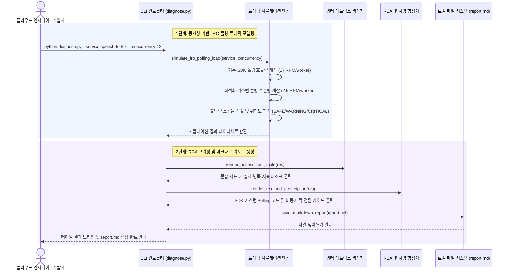

<!--
Copyright 2026 Google LLC. All Rights Reserved.
SPDX-License-Identifier: Apache-2.0

NOTICE: This code/repository is owned by Google LLC and provided under the Apache-2.0 License.
It is strictly provided as an EXAMPLE/REFERENCE ONLY and is NOT INTENDED FOR PRODUCTION USE.
All contents, designs, and code examples are subject to change, modification, or removal at any time without notice.

[고지 사항] 본 저장소 및 문서는 구글 (Google LLC) 소유이며 Apache 2.0 라이선스 하에 예시 (Sample) 용도로 제공된다.
프로덕션 환경용이 아니며, 사전 통지 없이 언제든지 수정, 변경 또는 삭제될 수 있다.
-->

> [!IMPORTANT]
> **구글 (Google LLC) 참조용 샘플 고지 사항**:
> 본 프로젝트의 모든 소스 코드와 문서는 Google LLC의 소유이며, Apache-2.0 라이선스에 따라 오직 **참조용 샘플 (Sample / Reference Only)** 목적으로만 제공된다. 프로덕션 환경에 그대로 사용할 수 없으며, 사전 통지 없이 언제든 내용이 수정, 변경 또는 삭제될 수 있다.

# 기술 상세 설계서 (TDD): lro-polling-quota-guard

## 1. 아키텍처 개요 및 설계 원칙
본 시스템은 Google Cloud LRO 비동기 작업 처리 시 클라이언트 SDK(`google-api-core`)의 내부 폴링 주기가 유발하는 쿼터 초과 현상을 분석하는 단일 파이썬 진단 도구(`diagnose.py`)로 구성되며, 터미널 출력과 함께 마크다운 리포트(`report.md`)를 자동 생성한다.

---

## 2. 시스템 아키텍처 및 런타임 상호작용 시퀀스

본 도구의 런타임 제어 및 데이터 상호작용 흐름은 아래 시퀀스 다이어그램과 같다. 운영자 또는 개발자가 CLI를 실행하면 동시 비동기 작업 수에 따른 SDK 기본 폴링 vs 권장 지수 백오프 폴링 호출량을 시뮬레이션하고, 서비스별 쿼터 소진 위험도 판정 및 커스텀 Polling 코드 스니펫과 아키텍처 개선안을 산출한다.

---

## 3. 요구 사항 추적성 매핑 (Traceability Matrix)

| 비즈니스 요구 사항 (BRD) | 기능적 기술 요구 사항 (FR) | 비기능적 기술 요구 사항 (NFR) | 구현 파일 및 모듈 |
| :--- | :--- | :--- | :--- |
| **BR-01** (다중 LRO 서비스 백그라운드 폴링 모델링) | **FR-01** (동시성 기반 LRO 폴링 트래픽 모델링) | **NFR-02** (가상 실행 모드) | `diagnose.py` (`simulate_lro_polling_load`) |
| **BR-02** (대시보드 지표 착시 규명 및 RCA) | **FR-02** (진단 리포트 및 RCA 출력) | **NFR-01** (크로스 플랫폼 실행) | `diagnose.py` (`render_assessment_table`, `render_rca_and_prescription`) |
| **BR-03** (클라이언트 SDK 즉각 조치 처방) | **FR-03** (SDK 커스텀 Polling 코드 스니펫 자동 생성) | **NFR-01** (크로스 플랫폼 실행) | `diagnose.py` (`render_rca_and_prescription`) |
| **BR-04** (엔터프라이즈 비동기 큐 분리 가이드) | **FR-04** (마크다운 진단 리포트 자동 생성) | **NFR-04** (리포트 절대 경로 저장) | `diagnose.py` (`build_markdown_report`, `save_markdown_report`) |
| **BR-05** (사내 거버넌스 4대 필수 라벨링) | **FR-05** (사내 거버넌스 4대 필수 라벨링 적용) | **NFR-03** (자동 탐지 우선) | `README.md`, `diagnose.py` |

---

## 4. 기능 요구 사항 (Functional Requirements)

### FR-01: 동시성 기반 LRO 폴링 트래픽 모델링
- 동시 작업 수 $N$에 대해 기본 SDK 폴링 호출량 $R_{default} = N \times 17 \text{ RPM}$ 및 최적화 폴링 호출량 $R_{opt} = N \times 2.5 \text{ RPM}$을 계산한다.
- 서비스별 할당량 $Q_{limit}$ 대비 소진율을 산출하여 100% 이상 시 `CRITICAL_RISK`, 70% 이상 시 `WARNING_RISK`, 미만 시 `SAFE`로 판정한다.

### FR-02: 진단 리포트 및 RCA 출력
- 주 작업 요청 쿼터 토큰과 `operation_requests` 쿼터 토큰을 구분한 매트릭스 표를 출력한다.
- 429 오류의 근본 원인을 설명하는 RCA 텍스트를 구성한다.

### FR-03: SDK 커스텀 Polling 코드 스니펫 자동 생성
- `google.api_core.polling.DEFAULT_POLLING.with_delay(initial=15.0, maximum=30.0, multiplier=1.5)` 적용 코드를 화면에 출력한다.

### FR-04: 마크다운 진단 리포트 (report.md) 자동 생성 및 덮어쓰기
- 진단 실행 시 터미널 출력과 동일한 평가 지표 및 코드 처방전을 담은 `report.md` 파일을 자동 기록/갱신하여 사내 문서 공유 및 복습을 지원한다.

### FR-05: 사내 거버넌스 4대 필수 라벨링 적용
- 비동기 LRO 파이프라인 연계 리소스 구성 시 `managed-by=google-cloud-0-to-1`, `scenario=lro-polling-quota-guard`, `env=sample`, `created-by=customer-engineer` 라벨을 필수로 주입한다.

---

## 5. 비기능 요구 사항 (Non-Functional Requirements)

### NFR-01: 크로스 플랫폼 순수 파이썬 직접 실행
- 쉘 래퍼 종속성 없이 `python diagnose.py` 단일 명령어로 크로스 플랫폼(Linux, macOS, Windows)에서 직접 실행된다.

### NFR-02: 가상 실행 모드 (--dry-run)
- 실제 클라우드 API 호출이나 권한 요구 없이 모의 계산 데이터를 통해 결과를 즉시 검증할 수 있어야 한다.

### NFR-03: 자동 탐지 우선 (Auto-Discovery First)
- CLI 인자가 생략되었을 때 gcloud 활성 프로젝트 및 리전 설정을 계층적으로 탐색하여 자동 설정한다.

### NFR-04: 리포트 절대 경로 저장 보장
- 로컬 진단 스크립트 실행 시 산출물 저장 경로는 스크립트 파일이 위치한 디렉터리의 절대 경로를 기준으로 저장하여 작업 디렉터리와 무관하게 안정적인 저장을 보장한다.
