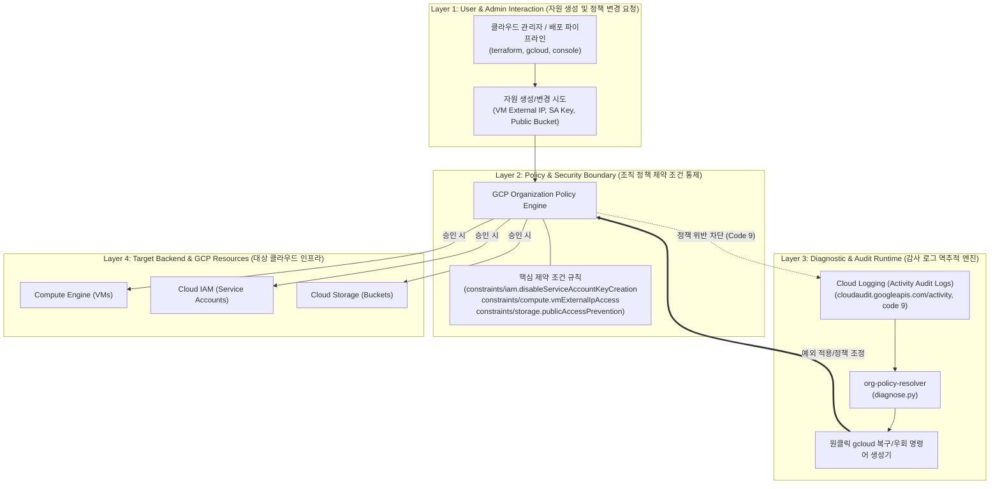

<!--
Copyright 2026 Google LLC. All Rights Reserved.
SPDX-License-Identifier: Apache-2.0

NOTICE: This code/repository is owned by Google LLC and provided under the Apache-2.0 License.
It is strictly provided as an EXAMPLE/REFERENCE ONLY and is NOT INTENDED FOR PRODUCTION USE.
All contents, designs, and code examples are subject to change, modification, or removal at any time without notice.

[고지 사항] 본 저장소 및 문서는 구글 (Google LLC) 소유이며 Apache 2.0 라이선스 하에 예시 (Sample) 용도로 제공된다.
프로덕션 환경용이 아니며, 사전 통지 없이 언제든지 수정, 변경 또는 삭제될 수 있다.
-->

> [!IMPORTANT]
> **구글 (Google LLC) 참조용 샘플 고지 사항**:
> 본 프로젝트의 모든 소스 코드와 문서는 Google LLC의 소유이며, Apache-2.0 라이선스에 따라 오직 **참조용 샘플 (Sample / Reference Only)** 목적으로만 제공된다. 프로덕션 환경에 그대로 사용할 수 없으며, 사전 통지 없이 언제든 내용이 수정, 변경 또는 삭제될 수 있다.

# GCP 조직 정책(Organization Policy) 위반 감사 역추적 및 복구 (org-policy-resolver)

GCP 환경에서 자원 생성 또는 권한 변경 시 발생하는 조직 정책 제약 조건(Constraints) 위반 에러를 감사 로그에서 역추적하고, **위반된 제약 조건 ID와 즉시 복구/우회 가능한 gcloud 명령어를 1분 만에 자동 처방**하는 도구다. (As of 2026-10-17)

---

## 1. 발생 증상 및 진단 대상 체크리스트

사내 또는 고객사 환경에서 아래 증상이 발생한다면 즉시 진단 대상이다:
- [ ] **자원 생성 중 제약 조건(Constraints) 차단**: VM 인스턴스 외부 IP 할당, 서비스 계정 키 생성, 스토리지 공개 버킷 생성 시 `Failed Precondition (code 9)` 오류와 함께 작업이 거부될 때
- [ ] **위반된 정확한 조직 정책 ID 규명**: 에러 메시지가 길거나 복잡하여 정확히 어떤 조직 정책(`constraints/...`)에 걸렸는지 신속히 파악하기 어려울 때
- [ ] **테스트/개발 프로젝트 단위의 안전한 정책 해제**: 전사 정책을 훼손하지 않고 해당 프로젝트에 한해 신속히 예외를 적용할 수 있는 `gcloud resource-manager org-policies disable-enforce` 명령어를 즉시 확보하고자 할 때


### 1.1 도구의 본질 및 비즈니스 해결 과제 (What & Why)
- **대상 사용자 (Target)**: 클라우드 인프라 관리자, 중앙 거버넌스 팀, DevOps 엔지니어 및 프로젝트 운영자
- **해결하는 핵심 문제 (Core Pain Points)**:
  1. 리소스 생성이나 IAM 권한 변경 시 조직 정책 제약 조건(Constraints)에 의해 거부되었으나 정확한 제약 ID를 모르는 문제
  2. 개발 환경이나 테스트 프로젝트에서 긴급히 리소스를 띄워야 하는데 상위 조직 정책에 막혀 작업이 중단되는 현상
  3. 수많은 실패 로그 속에서 어떤 주체가 어떤 제약 조건을 위반했는지 감사 로그를 일일이 분석하는 데 소요되는 시간 낭비
- **본 솔루션의 해결 방식 (Solution)**:
  - Cloud Audit Logs에서 최근 7일간의 조직 정책 위반 실패 이벤트를 정밀 역추적하여 위반된 제약 조건 ID(예: `compute.requireShieldedVm`, `iam.disableServiceAccountKeyCreation`)를 규명하고 프로젝트 레벨 우회/복구 명령어를 도출한다.

### 1.2 최종 산출물 3종 세트 미리보기 (Deliverables & Visual Preview)
본 도구를 실행(`python diagnose.py`)하면 다음 3가지 구체적인 엔터프라이즈 자산이 생성된다:

| 산출물 구분 | 산출물 형태 및 명칭 | 주요 포함 내용 및 실무 활용 방안 |
| :--- | :--- | :--- |
| **① 터미널 콘솔 요약** | Visual CLI Table | 위반 시각, 실패 주체, 요청 서비스, 실행 실패 액션, 검출된 제약 조건 ID 및 조치 명령 요약 표 |
| **② 정규 진단 보고서** | 마크다운 파일 (`report.md`) | 조직 정책 위반 전수 감사 보고서, 제약 조건별 기술적 영향도 분석, 프로젝트 레벨 복구 gcloud 명령어 세트 |
| **③ 후속 조치 및 배포 자산** | Actionable Asset Specs | • **원클릭 조직 정책 우회 gcloud 명령어**: 프로젝트 레벨에서 안전하게 제약을 해제하는 명령어<br/>• **조직 정책 정합성 검증 스크립트**: 상위 조직 정책 상속 상태를 점검하는 gcloud 명령<br/>• **거버넌스 준수 리소스 생성 가이드**: 조직 제약을 준수하면서 리소스를 프로비저닝하는 표준 템플릿 |

---

## 2. 빠른 시작 (Quickstart)

> [!TIP]
> Cloud Shell 접속 환경 구성 및 저장소 클론(`git clone`) 방법은 루트의 [메인 README](../../README.md)를 참고한다.

### 1) 모의 데이터 가상 실행 (Dry-Run)
GCP API 호출 없이 내장된 가상 인프라 데이터로 정상 동작 여부를 즉시 검증한다:
```bash
python diagnose.py --dry-run
```

**터미널 진단 출력 미리보기:**
```text
[진단 결과] GCP 조직 정책(Organization Policy) 위반 감사 추적 리포트
  - 대상 프로젝트: sample-project-id
  - 조회 기간: 최근 7일
========================================================================
발견된 조직 정책 위반 실패 내역: 3건
[위반 건 #1]
  - 실패 주체 계정  : security-engineer@company.com
  - 요청 대상 서비스: iam.googleapis.com
  - 실행 실패 액션  : google.iam.admin.v1.CreateServiceAccountKey
  - 실제 오류 내용  : Operation denied by organization policy: constraints/iam.disableServiceAccountKeyCreation violated
```


### 2) 사내 환경 대화형 설정 (Config Wizard, 선택 사항)
사내 활성 프로젝트 및 환경 설정을 대화형으로 탐색하여 `.env`에 자동 저장한다:
```bash
python diagnose.py --config
```


### 3) 실제 사내 인프라 실시간 진단
```bash
python diagnose.py
```
> [!NOTE]
> 앞서 `python diagnose.py --config`로 환경 설정을 저장했거나 gcloud 활성 설정을 그대로 활용할 경우 별도의 `.env` 생성 없이 즉시 실행할 수 있다. (환경 변수를 텍스트 에디터로 직접 수동 편집하고자 할 때만 `cp -n .env.example .env` 실행 후 수정)

---

## 3. 솔루션 아키텍처 및 처리 흐름



---
## 4. 조치 가이드 및 권장 설정

- **조직 정책 관리 콘솔**: ( https://console.cloud.google.com/iam-admin/orgpolicies )
- **Cloud Logging 탐색기**: ( https://console.cloud.google.com/logs/viewer )
- **공식 문서 - 조직 정책 제약 조건 목록**: ( https://cloud.google.com/resource-manager/docs/organization-policy/org-policy-constraints )

---
### GCP 리소스 생성 시 4대 필수 표준 라벨링 준수
- 사내 거버넌스 및 자원 식별, 비용 추적을 위해 관련 클라우드 리소스 생성 시 4대 표준 라벨을 필수로 주입한다:
  - `managed-by`: `google-cloud-0-to-1`
  - `scenario`: `org-policy-resolver`
  - `env`: `sample`
  - `created-by`: `customer-engineer`
- gcloud CLI 예시: `--labels=managed-by=google-cloud-0-to-1,scenario=org-policy-resolver,env=sample,created-by=customer-engineer`

---

## 5. 사전 준비 사항 (필요 IAM 권한)

본 도구를 실행하려면 최소 아래의 IAM 권한이 필요하다:

감사 로그를 조회하고 조직 정책을 수정하기 위해 필요한 역할 목록이다:

| 역할 (Role) | 설명 |
| :--- | :--- |
| 로그 뷰어(`roles/logging.viewer`) | Cloud Logging 활동 감사 로그 읽기 |
| 조직 정책 관리자(`roles/orgpolicy.policyAdmin`) | 프로젝트 레벨 조직 정책 제약 조건 비활성화 |

> [!NOTE]
> `--dry-run` 모드로 실행할 경우 별도의 권한 없이도 가상 위반 시나리오와 처방 명령어 형식을 즉시 확인할 수 있다.

---

## 6. 기술적 배경 및 아키텍처 원리 (Deep Dive)

### 관련 상세 설계 및 요구 사항 명세
- [비즈니스 요구 사항 명세서 (BRD)](docs/BRD.md): 비즈니스 배경, 성공 지표 및 요구 사항(BR-01~) 명세
- [기술 상세 설계서 (TDD)](docs/TDD.md): 시스템 아키텍처, 기능(FR-01~) 및 비기능(NFR-01~) 설계 명세

스크립트가 완료되면 아래와 같이 **위반 내역과 즉시 복구할 수 있는 복사 가능한 gcloud 명령어**가 출력된다:

```text
========================================================================
[진단 결과] GCP 조직 정책(Organization Policy) 위반 감사 추적 리포트
  - 대상 프로젝트: my-prod-project
  - 조회 기간: 최근 7일
========================================================================

발견된 조직 정책 위반 실패 내역: 3건

[위반 건 #1]
  - 실패 주체 계정  : security-engineer@company.com
  - 요청 대상 서비스: iam.googleapis.com
  - 실행 실패 액션  : google.iam.admin.v1.CreateServiceAccountKey
  - 실제 오류 내용  : Operation denied by organization policy: constraints/iam.disableServiceAccountKeyCreation violated
  [정밀 처방 제약 조건 분석]
    - 검출 제약 사항: constraints/iam.disableServiceAccountKeyCreation
    - 제약 조건 설명: 서비스 계정 키(JSON 키) 신규 생성을 전면 차단하는 조직 제약 조건이다.
    - 권장 임시 방안: 보안을 위해 워크로드 아이덴티티(Workload Identity) 연동을 권장하나, 테스트 및 마이그레이션 단계에서 키 발급이 불가피한 경우 해당 프로젝트에 한해 제약을 해제할 수 있다.
  [즉시 조치 가능한 원클릭 gcloud 해결 명령어]
    gcloud resource-manager org-policies disable-enforce "iam.disableServiceAccountKeyCreation" \
      --project="my-prod-project"
------------------------------------------------------------------------
```

---
## 7. 리소스 정리 (Teardown) 안내

본 도구는 순수 감사 로그 조회 도구이며 클라우드 상에 영구 자원을 생성하지 않으므로 별도의 자원 정리 작업이 필요하지 않다.
