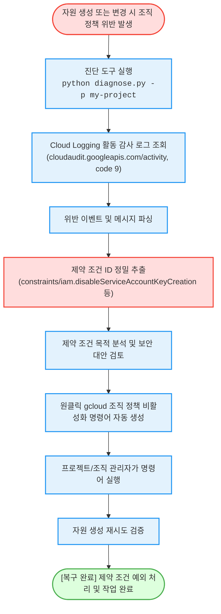

<!--
Copyright 2026 Google LLC. All Rights Reserved.
SPDX-License-Identifier: Apache-2.0

NOTICE: This code/repository is owned by Google LLC and provided under the Apache-2.0 License.
It is strictly provided as an EXAMPLE/REFERENCE ONLY and is NOT INTENDED FOR PRODUCTION USE.
All contents, designs, and code examples are subject to change, modification, or removal at any time without notice.

[고지 사항] 본 저장소 및 문서는 구글 (Google LLC) 소유이며 Apache 2.0 라이선스 하에 예시 (Sample) 용도로 제공된다.
프로덕션 환경용이 아니며, 사전 통지 없이 언제든지 수정, 변경 또는 삭제될 수 있다.
-->

> [!IMPORTANT]
> **구글 (Google LLC) 참조용 샘플 고지 사항**:
> 본 프로젝트의 모든 소스 코드와 문서는 Google LLC의 소유이며, Apache-2.0 라이선스에 따라 오직 **참조용 샘플 (Sample / Reference Only)** 목적으로만 제공된다. 프로덕션 환경에 그대로 사용할 수 없으며, 사전 통지 없이 언제든 내용이 수정, 변경 또는 삭제될 수 있다.

# GCP 조직 정책(Organization Policy) 위반 감사 역추적 및 복구 (org-policy-resolver)

GCP 환경에서 자원 생성 또는 권한 변경 시 발생하는 조직 정책 제약 조건(Constraints) 위반 에러를 감사 로그에서 역추적하고, **위반된 제약 조건 ID와 즉시 복구/우회 가능한 gcloud 명령어를 1분 만에 자동 처방**하는 도구다. (As of 2026-10-17)

---

## 1. 발생 증상 및 진단 대상 체크리스트

사내 또는 고객사 환경에서 아래 증상이 발생한다면 즉시 진단 대상이다:
- [ ] **자원 생성 중 제약 조건(Constraints) 차단**: VM 인스턴스 외부 IP 할당, 서비스 계정 키 생성, 스토리지 공개 버킷 생성 시 `Failed Precondition (code 9)` 오류와 함께 작업이 거부될 때
- [ ] **위반된 정확한 조직 정책 ID 규명**: 에러 메시지가 길거나 복잡하여 정확히 어떤 조직 정책(`constraints/...`)에 걸렸는지 신속히 파악하기 어려울 때
- [ ] **테스트/개발 프로젝트 단위의 안전한 정책 해제**: 전사 정책을 훼손하지 않고 해당 프로젝트에 한해 신속히 예외를 적용할 수 있는 `gcloud resource-manager org-policies disable-enforce` 명령어를 즉시 확보하고자 할 때

---

## 2. 빠른 시작 (Quickstart)

### 1) 모의 데이터 가상 실행 (Dry-Run)
GCP API 호출 없이 내장된 가상 인프라 데이터로 정상 동작 여부를 즉시 검증한다:
```bash
python diagnose.py --dry-run
```

**터미널 진단 출력 미리보기:**
```text
[진단 결과] GCP 조직 정책(Organization Policy) 위반 감사 추적 리포트
  - 대상 프로젝트: sample-project-id
  - 조회 기간: 최근 7일
========================================================================
발견된 조직 정책 위반 실패 내역: 3건
[위반 건 #1]
  - 실패 주체 계정  : security-engineer@company.com
  - 요청 대상 서비스: iam.googleapis.com
  - 실행 실패 액션  : google.iam.admin.v1.CreateServiceAccountKey
  - 실제 오류 내용  : Operation denied by organization policy: constraints/iam.disableServiceAccountKeyCreation violated
```

### 2) 실제 사내 인프라 실시간 진단
```bash
cp .env.example .env
python diagnose.py
```
> [!NOTE]
> `.env` 설정값을 비워두면 gcloud 활성 설정 및 사내 리소스를 자동으로 감지하여 진단한다.

---

## 3. 진단 및 해결 흐름



---
## 4. 조치 가이드 및 권장 설정

- **조직 정책 관리 콘솔**: ( https://console.cloud.google.com/iam-admin/orgpolicies )
- **Cloud Logging 탐색기**: ( https://console.cloud.google.com/logs/viewer )
- **공식 문서 - 조직 정책 제약 조건 목록**: ( https://cloud.google.com/resource-manager/docs/organization-policy/org-policy-constraints )

---
## 5. 사전 준비 사항 (필요 IAM 권한)

본 도구를 실행하려면 최소 아래의 IAM 권한이 필요하다:

감사 로그를 조회하고 조직 정책을 수정하기 위해 필요한 역할 목록이다:

| 역할 (Role) | 설명 |
| : | : |
| 로그 뷰어(`roles/logging.viewer`) | Cloud Logging 활동 감사 로그 읽기 |
| 조직 정책 관리자(`roles/orgpolicy.policyAdmin`) | 프로젝트 레벨 조직 정책 제약 조건 비활성화 |

> [!NOTE]
> `--dry-run` 모드로 실행할 경우 별도의 권한 없이도 가상 위반 시나리오와 처방 명령어 형식을 즉시 확인할 수 있다.

---

## 6. 기술적 배경 및 아키텍처 원리 (Deep Dive)

### 관련 상세 설계 및 요구 사항 명세
- [비즈니스 요구 사항 명세서 (BRD)](docs/BRD.md): 비즈니스 배경, 성공 지표 및 요구 사항(BR-01~) 명세
- [기술 상세 설계서 (TDD)](docs/TDD.md): 시스템 아키텍처, 기능(FR-01~) 및 비기능(NFR-01~) 설계 명세

스크립트가 완료되면 아래와 같이 **위반 내역과 즉시 복구할 수 있는 복사 가능한 gcloud 명령어**가 출력된다:

```text
========================================================================
[진단 결과] GCP 조직 정책(Organization Policy) 위반 감사 추적 리포트
  - 대상 프로젝트: my-prod-project
  - 조회 기간: 최근 7일
========================================================================

발견된 조직 정책 위반 실패 내역: 3건

[위반 건 #1]
  - 실패 주체 계정  : security-engineer@company.com
  - 요청 대상 서비스: iam.googleapis.com
  - 실행 실패 액션  : google.iam.admin.v1.CreateServiceAccountKey
  - 실제 오류 내용  : Operation denied by organization policy: constraints/iam.disableServiceAccountKeyCreation violated
  [정밀 처방 제약 조건 분석]
    - 검출 제약 사항: constraints/iam.disableServiceAccountKeyCreation
    - 제약 조건 설명: 서비스 계정 키(JSON 키) 신규 생성을 전면 차단하는 조직 제약 조건이다.
    - 권장 임시 방안: 보안을 위해 워크로드 아이덴티티(Workload Identity) 연동을 권장하나, 테스트 및 마이그레이션 단계에서 키 발급이 불가피한 경우 해당 프로젝트에 한해 제약을 해제할 수 있다.
  [즉시 조치 가능한 원클릭 gcloud 해결 명령어]
    gcloud resource-manager org-policies disable-enforce "iam.disableServiceAccountKeyCreation" \
      --project="my-prod-project"
------------------------------------------------------------------------
```

---
## 7. 리소스 정리 (Teardown) 안내

본 도구는 순수 감사 로그 조회 도구이며 클라우드 상에 영구 자원을 생성하지 않으므로 별도의 자원 정리 작업이 필요하지 않다.
