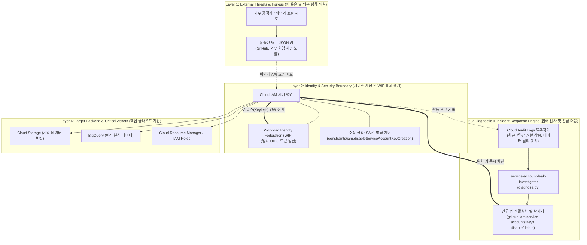

<!--
Copyright 2026 Google LLC. All Rights Reserved.
SPDX-License-Identifier: Apache-2.0

NOTICE: This code/repository is owned by Google LLC and provided under the Apache-2.0 License.
It is strictly provided as an EXAMPLE/REFERENCE ONLY and is NOT INTENDED FOR PRODUCTION USE.
All contents, designs, and code examples are subject to change, modification, or removal at any time without notice.

[고지 사항] 본 저장소 및 문서는 구글 (Google LLC) 소유이며 Apache 2.0 라이선스 하에 예시 (Sample) 용도로 제공된다.
프로덕션 환경용이 아니며, 사전 통지 없이 언제든지 수정, 변경 또는 삭제될 수 있다.
-->

> [!IMPORTANT]
> **구글 (Google LLC) 참조용 샘플 고지 사항**:
> 본 프로젝트의 모든 소스 코드와 문서는 Google LLC의 소유이며, Apache-2.0 라이선스에 따라 오직 **참조용 샘플 (Sample / Reference Only)** 목적으로만 제공된다. 프로덕션 환경에 그대로 사용할 수 없으며, 사전 통지 없이 언제든 내용이 수정, 변경 또는 삭제될 수 있다.

# 서비스 계정 유출 긴급 대응 및 감사 로그 역추적기 (service-account-leak-investigator)

유출된 서비스 계정 키의 악용 이력을 Cloud Audit Logs로 전수 추적하고, 위험 키 비활성화 및 Workload Identity Federation 전환을 지원하는 보안 긴급 대응 진단 도구다. (As of 2026-10-17)

---

## 1. 발생 증상 및 진단 대상 체크리스트

사내 또는 고객사 환경에서 아래 증상이 발생한다면 즉시 진단 대상이다:
- [ ] 깃허브(GitHub) 공개 저장소나 외부 협업 환경에 영구 서비스 계정 키(JSON Key)가 노출된 정황을 접수한 경우
- [ ] 사법 기관이나 보안 관제 센터로부터 자격 증명 유출 및 사이버 공격 악용 사실을 통보받은 경우
- [ ] 유출된 서비스 계정이 `Cloud Storage`, `BigQuery`, `Cloud IAM` 등 핵심 자원에서 데이터 탈취나 권한 상승을 시도했는지 즉시 확인해야 하는 경우
- [ ] 장기 서비스 계정 키를 전면 폐기하고 안전한 Workload Identity Federation 체계로 전환하고자 하는 경우


### 1.1 도구의 본질 및 비즈니스 해결 과제 (What & Why)
- **대상 사용자 (Target)**: 사내 침해사고 대응팀(CERT/CSIRT), CISO, 보안 운영 센터(SOC) 및 IAM 관리자
- **해결하는 핵심 문제 (Core Pain Points)**:
  1. GitHub 공개 저장소나 외부 협력사로 서비스 계정 정적 키(JSON)가 유출되었을 때 악용 여부를 신속히 파악하기 어려운 문제
  2. 유출된 키가 언제, 어떤 IP에서, 어떤 민감 API(BigQuery 데이터 반출, VM 생성 등)를 호출했는지 타임라인 재구성이 지연되는 사고
  3. 키를 무조건 즉시 삭제했다가 연계된 프로덕션 핵심 서비스까지 중단되는 2차 운영 장애 위험
- **본 솔루션의 해결 방식 (Solution)**:
  - Cloud Audit Logs를 전수 스캔하여 유출된 서비스 계정 키의 고유 Key ID 기반 호출 이력, 출발지 IP, 실행 액션을 타임라인으로 재구성하고, 위험 키 비활성화 및 Workload Identity Federation(WIF) 전환 안전 가이드를 처방한다.

### 1.2 최종 산출물 3종 세트 미리보기 (Deliverables & Visual Preview)
본 도구를 실행(`python diagnose.py`)하면 다음 3가지 구체적인 엔터프라이즈 자산이 생성된다:

| 산출물 구분 | 산출물 형태 및 명칭 | 주요 포함 내용 및 실무 활용 방안 |
| :--- | :--- | :--- |
| **① 터미널 콘솔 요약** | Visual CLI Table | 유출 의심 키 ID, 최근 호출 건수, 호출 출발지 IP 목록, 비정상 활동 감지 여부 및 침해 위험 등급 표 |
| **② 정규 진단 보고서** | 마크다운 파일 (`report.md`) | 서비스 계정 침해 사고 정밀 포렌식 보고서, 시간대별 호출 타임라인, 비정상 API 호출 분석 및 긴급 격리 가이드 |
| **③ 후속 조치 및 배포 자산** | Actionable Asset Specs | • **위험 키 즉시 비활성화 명령어**: 프로덕션 복구를 염두에 두고 임시 중단하는 gcloud 명령<br/>• **Workload Identity Federation 전환 템플릿**: 정적 키 발급을 영구 제거하는 AWS/GitHub Actions WIF 설정<br/>• **비정상 위치/IP 접근 탐지 Cloud Monitoring 알림**: 해외 IP 호출 시 긴급 경보를 트리거하는 정책 |

---

## 2. 빠른 시작 (Quickstart)

> [!TIP]
> Cloud Shell 접속 환경 구성 및 저장소 클론(`git clone`) 방법은 루트의 [메인 README](../../README.md)를 참고한다.

### 1) 모의 데이터 가상 실행 (Dry-Run)
GCP API 호출 없이 내장된 가상 인프라 데이터로 정상 동작 여부를 즉시 검증한다:
```bash
python diagnose.py --dry-run
```

**터미널 진단 출력 미리보기:**
```text
서비스 계정           키 ID               생성 일자        상태       권장 조치
--------------------------------------------------------------------------------
app-backend-sa   7f8b9c0d1e2f...    2025-11-10   ACTIVE   즉시 비활성화(DISABLE) 및 영구 삭제 권장
app-backend-sa   a1b2c3d4e5f6...    2026-05-15   ACTIVE   침해 의심 시점 생성 키, 즉시 삭제 필요
data-pipeline-sa 7f8b9c0d1e2f...    2025-11-10   ACTIVE   즉시 비활성화(DISABLE) 및 영구 삭제 권장
data-pipeline-sa a1b2c3d4e5f6...    2026-05-15   ACTIVE   침해 의심 시점 생성 키, 즉시 삭제 필요
--------------------------------------------------------------------------------
[2단계] 최근 7일간 Cloud Audit Logs 위험 활동 역추적
--------------------------------------------------------------------------------
발생 시각                    계정              서비스        메서드             호출 IP           위험도
```


### 2) 사내 환경 대화형 설정 (Config Wizard, 선택 사항)
사내 활성 프로젝트 및 환경 설정을 대화형으로 탐색하여 `.env`에 자동 저장한다:
```bash
python diagnose.py --config
```


### 3) 실제 사내 인프라 실시간 진단
```bash
python diagnose.py
```
> [!NOTE]
> 앞서 `python diagnose.py --config`로 환경 설정을 저장했거나 gcloud 활성 설정을 그대로 활용할 경우 별도의 `.env` 생성 없이 즉시 실행할 수 있다. (환경 변수를 텍스트 에디터로 직접 수동 편집하고자 할 때만 `cp -n .env.example .env` 실행 후 수정)

---

## 3. 솔루션 아키텍처 및 처리 흐름



---
## 4. 조치 가이드 및 권장 설정

1. **유출 키 즉시 비활성화 및 삭제**:
   - IAM 및 관리자 > 서비스 계정 ( https://console.cloud.google.com/iam-admin/serviceaccounts )
   - 즉시 조치 CLI:
     ```bash
     gcloud iam service-accounts keys disable KEY_ID --iam-account=SERVICE_ACCOUNT_EMAIL
     gcloud iam service-accounts keys delete KEY_ID --iam-account=SERVICE_ACCOUNT_EMAIL
     ```
2. **Cloud Audit Logs 정밀 쿼리 확인**:
   - 로그 탐색기 ( https://console.cloud.google.com/logs/query )
   - Cloud Audit Logs 개요 ( https://cloud.google.com/logging/docs/audit )
3. **Workload Identity Federation 전환**:
   - 영구 JSON 키 발급을 전면 중단하고 임시 OIDC 토큰 기반 연동을 구성한다.
   - Workload Identity Federation 구성 ( https://cloud.google.com/iam/docs/workload-identity-federation )
   - 서비스 계정 키 관리 권장사항 ( https://cloud.google.com/iam/docs/best-practices-for-managing-service-account-keys )

---
### GCP 리소스 생성 시 4대 필수 표준 라벨링 준수
- 사내 거버넌스 및 자원 식별, 비용 추적을 위해 관련 클라우드 리소스 생성 시 4대 표준 라벨을 필수로 주입한다:
  - `managed-by`: `google-cloud-0-to-1`
  - `scenario`: `service-account-leak-investigator`
  - `env`: `sample`
  - `created-by`: `customer-engineer`
- gcloud CLI 예시: `--labels=managed-by=google-cloud-0-to-1,scenario=service-account-leak-investigator,env=sample,created-by=customer-engineer`

---

## 5. 사전 준비 사항 (필요 IAM 권한)

본 도구를 실행하려면 최소 아래의 IAM 권한이 필요하다:

본 도구를 실행하려면 최소 아래의 IAM 권한이 필요하다:

| 역할 (Role) | 최소 IAM 권한 |
| :--- | :--- |
| 로그 뷰어(`roles/logging.viewer`) | `logging.logEntries.list` |
| 보안 검토자(`roles/iam.securityReviewer`) | `iam.serviceAccountKeys.list`, `resourcemanager.projects.getIamPolicy` |

---

## 6. 기술적 배경 및 아키텍처 원리 (Deep Dive)

### 관련 상세 설계 및 요구 사항 명세
- [비즈니스 요구 사항 명세서 (BRD)](docs/BRD.md): 비즈니스 배경, 성공 지표 및 요구 사항(BR-01~) 명세
- [기술 상세 설계서 (TDD)](docs/TDD.md): 시스템 아키텍처, 기능(FR-01~) 및 비기능(NFR-01~) 설계 명세

```text
================================================================================
유출 의심 서비스 계정 감사 로그 역추적 및 침해 진단 리포트
진단 모드: 가상 실행 (Dry-run)
대상 프로젝트: demo-compromised-investigation
조사 기간: 최근 7일
조사 대상 계정 수: 2개
================================================================================

[1단계] 서비스 계정 활성 키(User-Managed Key) 현황 점검
--------------------------------------------------------------------------------
서비스 계정           키 ID               생성 일자        상태       권장 조치
--------------------------------------------------------------------------------
app-backend-sa   7f8b9c0d1e2f...    2025-11-10   ACTIVE   즉시 비활성화(DISABLE) 및 영구 삭제 권장
app-backend-sa   a1b2c3d4e5f6...    2026-05-15   ACTIVE   침해 의심 시점 생성 키, 즉시 삭제 필요
data-pipeline-sa 7f8b9c0d1e2f...    2025-11-10   ACTIVE   즉시 비활성화(DISABLE) 및 영구 삭제 권장
data-pipeline-sa a1b2c3d4e5f6...    2026-05-15   ACTIVE   침해 의심 시점 생성 키, 즉시 삭제 필요
--------------------------------------------------------------------------------

[2단계] 최근 7일간 Cloud Audit Logs 위험 활동 역추적
--------------------------------------------------------------------------------
발생 시각                    계정              서비스        메서드             호출 IP           위험도
--------------------------------------------------------------------------------
2026-09-09 07:20:00 UTC  app-backend-sa  iam        SetIamPolicy    198.51.100.45   HIGH
  └ 상세 내용: 외부 미인가 계정에 roles/owner 권한 부여 시도 감지
2026-09-09 04:20:00 UTC  data-pipeline-sa storage    get             203.0.113.88    HIGH
  └ 상세 내용: 비정상 해외 IP 대역에서 sensitive-customer-pii 버킷 대량 다운로드
2026-09-08 19:20:00 UTC  app-backend-sa  bigquery   InsertJob       198.51.100.45   HIGH
  └ 상세 내용: 외부 공개 스토리지 버킷으로 결제 및 사용자 테이블 추출 쿼리 실행
2026-09-08 09:20:00 UTC  data-pipeline-sa storage    list            203.0.113.88    MEDIUM
  └ 상세 내용: 사내 백업 버킷 내부 객체 목록 전수 정찰(Enumeration)
2026-09-07 09:20:00 UTC  app-backend-sa  storage    get             192.0.2.10      LOW
  └ 상세 내용: 정상 빌드 파이프라인 버킷 메타데이터 확인

--------------------------------------------------------------------------------
진단 요약: 총 5건의 활동 중 고위험(HIGH) 이벤트 3건 탐지
--------------------------------------------------------------------------------

[3단계] 긴급 대응 조치 및 Workload Identity Federation 전환 처방
1. 유출된 서비스 계정 키 즉시 비활성화(Disable):
   gcloud iam service-accounts keys disable <KEY_ID> --iam-account=<SA_EMAIL>
2. 악의적으로 부여된 비인가 IAM 바인딩 제거:
   gcloud projects remove-iam-policy-binding <PROJECT_ID> --member=<USER> --role=<ROLE>
3. 영구 자격 증명 폐기 및 Workload Identity Federation 전환:
   - 깃허브 액션(GitHub Actions) 환경: OIDC 연동 풀(Pool) 생성 후 단기 토큰 발급 체계로 전면 전환
   - 온프레미스 서버 환경: mTLS 기반 SPIFFE/SPIRE 또는 IdP SAML/OIDC 페더레이션 적용
================================================================================
```

---
## 7. 리소스 정리 (Teardown) 안내

본 진단 도구는 읽기 전용 감사 로그 및 키 상태 점검만 수행하므로 별도의 클라우드 인프라 자원을 생성하지 않는다. 테스트용으로 비활성화하거나 생성한 서비스 계정 키가 있다면 아래 명령어로 정리한다:

```bash
gcloud iam service-accounts keys delete KEY_ID --iam-account=SERVICE_ACCOUNT_EMAIL
```
