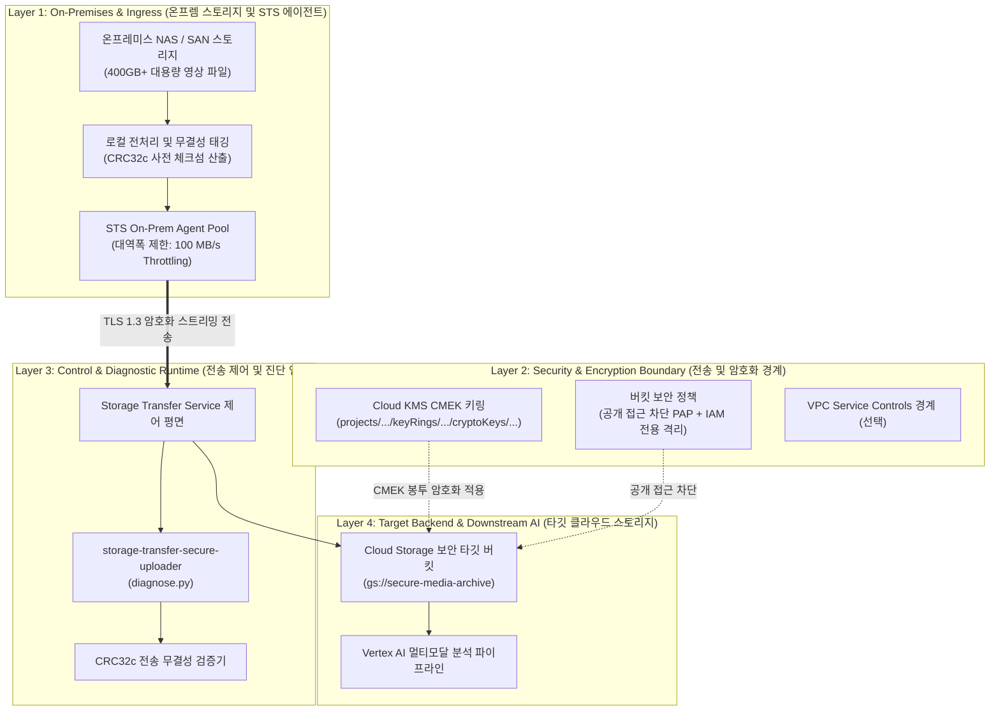

<!--
Copyright 2026 Google LLC. All Rights Reserved.
SPDX-License-Identifier: Apache-2.0

NOTICE: This code/repository is owned by Google LLC and provided under the Apache-2.0 License.
It is strictly provided as an EXAMPLE/REFERENCE ONLY and is NOT INTENDED FOR PRODUCTION USE.
All contents, designs, and code examples are subject to change, modification, or removal at any time without notice.

[고지 사항] 본 저장소 및 문서는 구글 (Google LLC) 소유이며 Apache 2.0 라이선스 하에 예시 (Sample) 용도로 제공된다.
프로덕션 환경용이 아니며, 사전 통지 없이 언제든지 수정, 변경 또는 삭제될 수 있다.
-->

> [!IMPORTANT]
> **구글 (Google LLC) 참조용 샘플 고지 사항**:
> 본 프로젝트의 모든 소스 코드와 문서는 Google LLC의 소유이며, Apache-2.0 라이선스에 따라 오직 **참조용 샘플 (Sample / Reference Only)** 목적으로만 제공된다. 프로덕션 환경에 그대로 사용할 수 없으며, 사전 통지 없이 언제든 내용이 수정, 변경 또는 삭제될 수 있다.

# 온프레미스 대용량 영상 STS 보안 전송 파이프라인 진단기 (storage-transfer-secure-uploader)

온프레미스 파일 서버에 보관된 대용량 영상(400GB 이상)을 Storage Transfer Service(STS)를 통해 클라우드 KMS(Cloud KMS) 암호화 및 무결성 검증을 거쳐 클라우드 스토리지(Cloud Storage)로 안전하게 이관하는 진단 도구다. (As of 2026-10-17)

---

## 1. 발생 증상 및 진단 대상 체크리스트

사내 또는 고객사 환경에서 아래 증상이 발생한다면 즉시 진단 대상이다:
- [ ] 현장 온프레미스 NAS/SAN 스토리지에 적재된 수백 기가바이트 이상의 영상 데이터를 버텍스 AI(Vertex AI) 멀티모달 분석용으로 클라우드에 이전하고자 할 때
- [ ] 네트워크 대역폭 고갈을 방지하기 위해 정밀한 대역폭 제한(Bandwidth Throttling)을 적용하고 전송 에이전트 상태를 실시간 진단해야 하는 경우
- [ ] 국가 핵심 기술 및 기업 보안 규정에 맞추어 사전 비식별화, 전송 중 CRC32c 체크섬 검증, 타깃 버킷 Cloud KMS CMEK 이중 암호화, 공개 접근 차단(PAP)을 일괄 점검하고자 하는 경우


### 1.1 도구의 본질 및 비즈니스 해결 과제 (What & Why)
- **대상 사용자 (Target)**: 미디어 엔지니어, 빅데이터 아키텍트, 온프레미스 인프라 관리자 및 클라우드 스토리지 팀
- **해결하는 핵심 문제 (Core Pain Points)**:
  1. 온프레미스 파일 서버에 보관된 대용량 미디어 파일(수백 GB~수 TB)을 수동 업로드하다가 네트워크 끊김이나 타임아웃으로 실패하는 문제
  2. 영상 파일 내 개인정보(차량 번호판, 행인 얼굴 등)가 비식별화되지 않은 채 클라우드로 업로드되어 발생하는 보안 위반 위험
  3. 대역폭 제한 없이 전송하다가 사내 업무 네트워크 전체가 마비되거나 데이터 체크섬 정합성 검증이 누락되는 현상
- **본 솔루션의 해결 방식 (Solution)**:
  - Storage Transfer Service(STS) 온프레미스 에이전트 풀 상태, 타깃 버킷의 CMEK 암호화 및 공개 접근 차단(PAP) 상태, 대역폭 제한(100 MB/s) 및 CRC32c 데이터 정합성 검증을 사전 진단하고 원클릭 전송 작업을 생성한다.

### 1.2 최종 산출물 3종 세트 미리보기 (Deliverables & Visual Preview)
본 도구를 실행(`python diagnose.py`)하면 다음 3가지 구체적인 엔터프라이즈 자산이 생성된다:

| 산출물 구분 | 산출물 형태 및 명칭 | 주요 포함 내용 및 실무 활용 방안 |
| :--- | :--- | :--- |
| **① 터미널 콘솔 요약** | Visual CLI Table | 로컬 전처리 상태, STS 에이전트 풀 연결 여부, 버킷 보안 통제, CMEK 적용, CRC32c 검증 5대 단계 판정 표 |
| **② 정규 진단 보고서** | 마크다운 파일 (`report.md`) | 대용량 미디어 안전 전송 사전 진단서, 단계별 보안 정합성 검증 결과, 대역폭 제한 적용 전송 작업 생성 명령어 |
| **③ 후속 조치 및 배포 자산** | Actionable Asset Specs | • **STS 전송 작업(Job) 생성 gcloud 명령어**: 대역폭 제한(100MB/s)과 정합성 해시 검증이 결합된 명령<br/>• **온프레미스 도커 에이전트 풀 설치 스크립트**: 사내 서버에 경량 에이전트를 구성하는 명령어<br/>• **타깃 버킷 보안 강화 설정**: 공개 접근 차단(PAP) 및 서울 리전 KMS 키를 강제하는 버킷 정책 |

---

## 2. 빠른 시작 (Quickstart)

> [!TIP]
> Cloud Shell 접속 환경 구성 및 저장소 클론(`git clone`) 방법은 루트의 [메인 README](../../README.md)를 참고한다.

### 1) 모의 데이터 가상 실행 (Dry-Run)
GCP API 호출 없이 내장된 가상 인프라 데이터로 정상 동작 여부를 즉시 검증한다:
```bash
python diagnose.py --dry-run
```

**터미널 진단 출력 미리보기:**
```text
=====================================================================================
온프레미스 대용량 미디어 STS 전송 및 보안 무결성 사전 진단 리포트
진단 모드: 가상 실행 (Dry-run)
대상 프로젝트: sample-project-id
타깃 버킷: gs://secure-media-archive
STS 에이전트 풀: on-prem-posix-pool
설정 대역폭 제한: 100 MB/s
=====================================================================================
[안전 전송 파이프라인 점검 현황]
-------------------------------------------------------------------------------------
```


### 2) 사내 환경 대화형 설정 (Config Wizard, 선택 사항)
사내 활성 프로젝트 및 환경 설정을 대화형으로 탐색하여 `.env`에 자동 저장한다:
```bash
python diagnose.py --config
```


### 3) 실제 사내 인프라 실시간 진단
```bash
python diagnose.py
```
> [!NOTE]
> 앞서 `python diagnose.py --config`로 환경 설정을 저장했거나 gcloud 활성 설정을 그대로 활용할 경우 별도의 `.env` 생성 없이 즉시 실행할 수 있다. (환경 변수를 텍스트 에디터로 직접 수동 편집하고자 할 때만 `cp -n .env.example .env` 실행 후 수정)

---

## 3. 솔루션 아키텍처 및 처리 흐름



---
## 4. 조치 가이드 및 권장 설정

1. **Storage Transfer Service 온프레미스 에이전트 관리**:
   - Storage Transfer Service > 온프레미스 ( https://console.cloud.google.com/transfer/on-premises )
   - 온프레미스 데이터 전송 개요 ( https://cloud.google.com/storage-transfer/docs/on-prem-overview )
   - 온프레미스 에이전트 풀 관리 ( https://cloud.google.com/storage-transfer/docs/on-prem-agent-pools )
2. **Cloud Storage 버킷 보안 강화**:
   - Cloud Storage > 버킷 브라우저 ( https://console.cloud.google.com/storage/browser )
   - 공개 접근 차단(PAP) 적용 ( https://cloud.google.com/storage/docs/public-access-prevention )

---
### GCP 리소스 생성 시 4대 필수 표준 라벨링 준수
- 사내 거버넌스 및 자원 식별, 비용 추적을 위해 관련 클라우드 리소스 생성 시 4대 표준 라벨을 필수로 주입한다:
  - `managed-by`: `google-cloud-0-to-1`
  - `scenario`: `storage-transfer-secure-uploader`
  - `env`: `sample`
  - `created-by`: `customer-engineer`
- gcloud CLI 예시: `--labels=managed-by=google-cloud-0-to-1,scenario=storage-transfer-secure-uploader,env=sample,created-by=customer-engineer`

---

## 5. 사전 준비 사항 (필요 IAM 권한)

본 도구를 실행하려면 최소 아래의 IAM 권한이 필요하다:

본 도구를 실행하려면 최소 아래의 IAM 권한이 필요하다:

| 역할 (Role) | 최소 IAM 권한 |
| :--- | :--- |
| 스토리지 관리자(`roles/storage.admin`) | `storage.buckets.get`, `storage.buckets.update` |
| 스토리지 전송 관리자(`roles/storagetransfer.admin`) | `storagetransfer.agentpools.list`, `storagetransfer.jobs.create` |

---

## 6. 기술적 배경 및 아키텍처 원리 (Deep Dive)

### 관련 상세 설계 및 요구 사항 명세
- [비즈니스 요구 사항 명세서 (BRD)](docs/BRD.md): 비즈니스 배경, 성공 지표 및 요구 사항(BR-01~) 명세
- [기술 상세 설계서 (TDD)](docs/TDD.md): 시스템 아키텍처, 기능(FR-01~) 및 비기능(NFR-01~) 설계 명세

```text
=====================================================================================
온프레미스 대용량 미디어 STS 전송 및 보안 무결성 사전 진단 리포트
진단 모드: 가상 실행 (Dry-run)
대상 프로젝트: demo-secure-multimodal-transfer
타깃 버킷: gs://secure-media-archive
STS 에이전트 풀: on-prem-posix-pool
설정 대역폭 제한: 100 MB/s
=====================================================================================

[안전 전송 파이프라인 점검 현황]
-------------------------------------------------------------------------------------
단계                   점검 항목                          결과     상세 상태
-------------------------------------------------------------------------------------
1. 온프렘 로컬 전처리     영상 비식별화 및 개인 식별 정보/번호판 마스킹 PASS     142개 영상 파일(총 417GB) 전수 비식별화 메타데이터 태그 확인 완료
2. STS 에이전트 풀       에이전트 풀 상태 (on-prem-posix-pool) PASS     온프레미스 도커 에이전트 4대 정상 연결 (상태: CONNECTED, 버전: 최신)
3. 버킷 보안 통제        타깃 버킷 공개 접근 차단 (PAP)     PASS     gs://secure-media-archive publicAccessPrevention=enforced 적용됨
4. 데이터 암호화         Cloud KMS CMEK 암호화 적용         PASS     서울 리전(asia-northeast3) KMS 키 바인딩됨
5. 무결성 검증 설정      CRC32c / MD5 체크섬 검증           PASS     전송 중 손상 방지를 위한 청크 단위 CRC32c 해시 대조 자동 활성화
-------------------------------------------------------------------------------------

[전송 작업(Job) 생성 및 실행 가이드]
1. 온프레미스 에이전트 풀 생성 및 실행 토큰 발급:
   gcloud transfer agent-pools create on-prem-posix-pool --project=demo-secure-multimodal-transfer --display-name='Secure On-Prem Pool'
2. 타깃 버킷 공개 접근 차단 및 CMEK 강제:
   gcloud storage buckets update gs://secure-media-archive --public-access-prevention
   gcloud storage buckets update gs://secure-media-archive --default-kms-key=projects/demo-secure-multimodal-transfer/locations/asia-northeast3/keyRings/media-ring/cryptoKeys/video-key
3. 대역폭 제한(100 MB/s) 적용 온프렘-to-GCS 전송 작업 생성:
   gcloud transfer jobs create posix-to-gcs /mnt/on-prem/cctv gs://secure-media-archive/cctv-2026/ --source-agent-pool=on-prem-posix-pool --project=demo-secure-multimodal-transfer
=====================================================================================
```

---
## 7. 리소스 정리 (Teardown) 안내

본 진단 도구는 전송 준비 상태를 검사하는 도구이며, 테스트용으로 생성한 전송 작업(Job)이나 에이전트 풀이 있다면 아래 명령어로 정리한다:

```bash
# 전송 작업 삭제
gcloud transfer jobs delete JOB_NAME --project=PROJECT_ID

# 온프레미스 에이전트 풀 삭제
gcloud transfer agent-pools delete AGENT_POOL --project=PROJECT_ID
```
