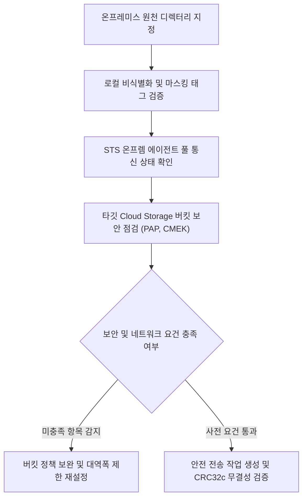

<!--
Copyright 2026 Google LLC. All Rights Reserved.
SPDX-License-Identifier: Apache-2.0

NOTICE: This code/repository is owned by Google LLC and provided under the Apache-2.0 License.
It is strictly provided as an EXAMPLE/REFERENCE ONLY and is NOT INTENDED FOR PRODUCTION USE.
All contents, designs, and code examples are subject to change, modification, or removal at any time without notice.

[고지 사항] 본 저장소 및 문서는 구글 (Google LLC) 소유이며 Apache 2.0 라이선스 하에 예시 (Sample) 용도로 제공된다.
프로덕션 환경용이 아니며, 사전 통지 없이 언제든지 수정, 변경 또는 삭제될 수 있다.
-->

> [!IMPORTANT]
> **구글 (Google LLC) 참조용 샘플 고지 사항**:
> 본 프로젝트의 모든 소스 코드와 문서는 Google LLC의 소유이며, Apache-2.0 라이선스에 따라 오직 **참조용 샘플 (Sample / Reference Only)** 목적으로만 제공된다. 프로덕션 환경에 그대로 사용할 수 없으며, 사전 통지 없이 언제든 내용이 수정, 변경 또는 삭제될 수 있다.

# 온프레미스 대용량 영상 STS 보안 전송 파이프라인 진단기 (storage-transfer-secure-uploader)

온프레미스 파일 서버에 보관된 대용량 영상(400GB 이상)을 Storage Transfer Service(STS)를 통해 클라우드 KMS(Cloud KMS) 암호화 및 무결성 검증을 거쳐 클라우드 스토리지(Cloud Storage)로 안전하게 이관하는 진단 도구다. (As of 2026-10-17)

---

## 1. 3단계 핵심 요약 (Input -> Detect -> Fix)

| 단계 | 실행 및 동작 | 기대 산출물 및 해결 과제 |
| :--- | :--- | :--- |
| **1. 실행 (Input)** | `python diagnose.py (또는 --dry-run)` | 활성 프로젝트 및 사내 리소스 자동 감지 |
| **2. 판정 (Detect)** | 텔레메트리 실시간 분석 | 온프레미스 대용량 영상의 STS 전송 시 네트워크 단절, 체크섬 불일치 및 KMS 암호화 누락 위험 진단 |
| **3. 처방 (Fix)** | 복붙용 조치 가이드 제공 | MD5/CRC32C 엔드투엔드 무결성 검증, CMEK 강제 암호화 및 다중 에이전트 대역폭 분할 가이드 도출 |

---

## 2. 발생 증상 및 진단 대상 체크리스트

사내 또는 고객사 환경에서 아래 증상이 발생한다면 즉시 진단 대상이다:
- [ ] 현장 온프레미스 NAS/SAN 스토리지에 적재된 수백 기가바이트 이상의 영상 데이터를 버텍스 AI(Vertex AI) 멀티모달 분석용으로 클라우드에 이전하고자 할 때
- [ ] 네트워크 대역폭 고갈을 방지하기 위해 정밀한 대역폭 제한(Bandwidth Throttling)을 적용하고 전송 에이전트 상태를 실시간 진단해야 하는 경우
- [ ] 국가 핵심 기술 및 기업 보안 규정에 맞추어 사전 비식별화, 전송 중 CRC32c 체크섬 검증, 타깃 버킷 Cloud KMS CMEK 이중 암호화, 공개 접근 차단(PAP)을 일괄 점검하고자 하는 경우

---

## 3. 빠른 시작 (Quickstart)

### 1) 모의 데이터 가상 실행 (Dry-Run)
GCP API 호출 없이 내장된 가상 인프라 데이터로 정상 동작 여부를 즉시 검증한다:
```bash
python diagnose.py --dry-run
```

**터미널 진단 출력 미리보기:**
```text
=====================================================================================
온프레미스 대용량 미디어 STS 전송 및 보안 무결성 사전 진단 리포트
진단 모드: 가상 실행 (Dry-run)
대상 프로젝트: sample-project-id
타깃 버킷: gs://secure-media-archive
STS 에이전트 풀: on-prem-posix-pool
설정 대역폭 제한: 100 MB/s
=====================================================================================
[안전 전송 파이프라인 점검 현황]
-------------------------------------------------------------------------------------
```

### 2) 실제 사내 인프라 실시간 진단
```bash
cp .env.example .env
python diagnose.py
```
> [!NOTE]
> `.env` 설정값을 비워두면 gcloud 활성 설정 및 사내 리소스를 자동으로 감지하여 진단한다.

---

## 4. 진단 및 해결 흐름



---
## 5. 조치 가이드 및 권장 설정

1. **Storage Transfer Service 온프레미스 에이전트 관리**:
   - Storage Transfer Service > 온프레미스 ( https://console.cloud.google.com/transfer/on-premises )
   - 온프레미스 데이터 전송 개요 ( https://cloud.google.com/storage-transfer/docs/on-prem-overview )
   - 온프레미스 에이전트 풀 관리 ( https://cloud.google.com/storage-transfer/docs/on-prem-agent-pools )
2. **Cloud Storage 버킷 보안 강화**:
   - Cloud Storage > 버킷 브라우저 ( https://console.cloud.google.com/storage/browser )
   - 공개 접근 차단(PAP) 적용 ( https://cloud.google.com/storage/docs/public-access-prevention )

---
## 6. 사전 준비 사항 (필요 IAM 권한)

본 도구를 실행하려면 최소 아래의 IAM 권한이 필요하다:

본 도구를 실행하려면 최소 아래의 IAM 권한이 필요하다:

| 역할 (Role) | 최소 IAM 권한 |
| : | : |
| 스토리지 관리자(`roles/storage.admin`) | `storage.buckets.get`, `storage.buckets.update` |
| 스토리지 전송 관리자(`roles/storagetransfer.admin`) | `storagetransfer.agentpools.list`, `storagetransfer.jobs.create` |

---

## 7. 기술적 배경 및 아키텍처 원리 (Deep Dive)

```text
=====================================================================================
온프레미스 대용량 미디어 STS 전송 및 보안 무결성 사전 진단 리포트
진단 모드: 가상 실행 (Dry-run)
대상 프로젝트: demo-secure-multimodal-transfer
타깃 버킷: gs://secure-media-archive
STS 에이전트 풀: on-prem-posix-pool
설정 대역폭 제한: 100 MB/s
=====================================================================================

[안전 전송 파이프라인 점검 현황]
-------------------------------------------------------------------------------------
단계                   점검 항목                          결과     상세 상태
-------------------------------------------------------------------------------------
1. 온프렘 로컬 전처리     영상 비식별화 및 개인 식별 정보/번호판 마스킹 PASS     142개 영상 파일(총 417GB) 전수 비식별화 메타데이터 태그 확인 완료
2. STS 에이전트 풀       에이전트 풀 상태 (on-prem-posix-pool) PASS     온프레미스 도커 에이전트 4대 정상 연결 (상태: CONNECTED, 버전: 최신)
3. 버킷 보안 통제        타깃 버킷 공개 접근 차단 (PAP)     PASS     gs://secure-media-archive publicAccessPrevention=enforced 적용됨
4. 데이터 암호화         Cloud KMS CMEK 암호화 적용         PASS     서울 리전(asia-northeast3) KMS 키 바인딩됨
5. 무결성 검증 설정      CRC32c / MD5 체크섬 검증           PASS     전송 중 손상 방지를 위한 청크 단위 CRC32c 해시 대조 자동 활성화
-------------------------------------------------------------------------------------

[전송 작업(Job) 생성 및 실행 가이드]
1. 온프레미스 에이전트 풀 생성 및 실행 토큰 발급:
   gcloud transfer agent-pools create on-prem-posix-pool --project=demo-secure-multimodal-transfer --display-name='Secure On-Prem Pool'
2. 타깃 버킷 공개 접근 차단 및 CMEK 강제:
   gcloud storage buckets update gs://secure-media-archive --public-access-prevention
   gcloud storage buckets update gs://secure-media-archive --default-kms-key=projects/demo-secure-multimodal-transfer/locations/asia-northeast3/keyRings/media-ring/cryptoKeys/video-key
3. 대역폭 제한(100 MB/s) 적용 온프렘-to-GCS 전송 작업 생성:
   gcloud transfer jobs create posix-to-gcs /mnt/on-prem/cctv gs://secure-media-archive/cctv-2026/ --source-agent-pool=on-prem-posix-pool --project=demo-secure-multimodal-transfer
=====================================================================================
```

---
## 8. 리소스 정리 (Teardown) 안내

본 진단 도구는 전송 준비 상태를 검사하는 도구이며, 테스트용으로 생성한 전송 작업(Job)이나 에이전트 풀이 있다면 아래 명령어로 정리한다:

```bash
# 전송 작업 삭제
gcloud transfer jobs delete JOB_NAME --project=PROJECT_ID

# 온프레미스 에이전트 풀 삭제
gcloud transfer agent-pools delete AGENT_POOL --project=PROJECT_ID
```
