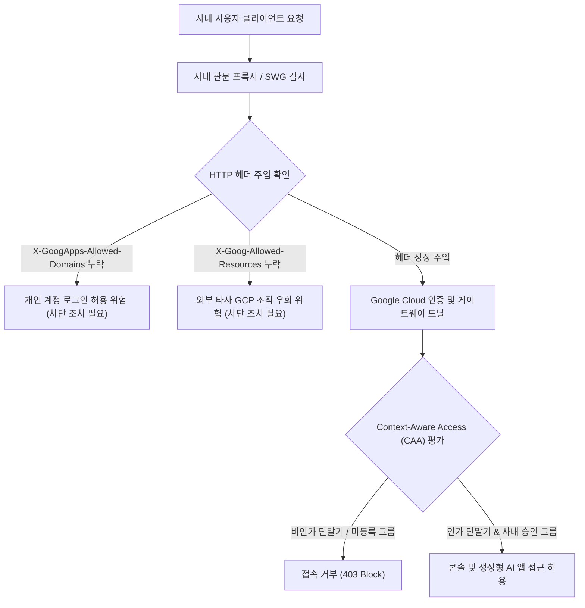

<!--
Copyright 2026 Google LLC. All Rights Reserved.
SPDX-License-Identifier: Apache-2.0

NOTICE: This code/repository is owned by Google LLC and provided under the Apache-2.0 License.
It is strictly provided as an EXAMPLE/REFERENCE ONLY and is NOT INTENDED FOR PRODUCTION USE.
All contents, designs, and code examples are subject to change, modification, or removal at any time without notice.

[고지 사항] 본 저장소 및 문서는 구글 (Google LLC) 소유이며 Apache 2.0 라이선스 하에 예시 (Sample) 용도로 제공된다.
프로덕션 환경용이 아니며, 사전 통지 없이 언제든지 수정, 변경 또는 삭제될 수 있다.
-->

> [!IMPORTANT]
> **구글 (Google LLC) 참조용 샘플 고지 사항**:
> 본 프로젝트의 모든 소스 코드와 문서는 Google LLC의 소유이며, Apache-2.0 라이선스에 따라 오직 **참조용 샘플 (Sample / Reference Only)** 목적으로만 제공된다. 프로덕션 환경에 그대로 사용할 수 없으며, 사전 통지 없이 언제든 내용이 수정, 변경 또는 삭제될 수 있다.

# 사내 관문 SWG 헤더 주입 및 Context-Aware Access 단말기 인가 진단 (swg-tenant-access-guard)

금융권 및 엔터프라이즈 환경에서 사내 관문 프록시(SWG)의 테넌트 제한 HTTP 헤더 주입 상태와 Context-Aware Access(CAA) 인가 단말기 접근 통제 정책을 종합 진단하여, 금융보안원 생성형 AI 보안대책 이행서 준수 및 외부 비인가 조직으로의 데이터 유출을 효과적으로 방어한다. (As of 2026-10-17)

---

## 1. 발생 증상 및 진단 대상 체크리스트

사내 또는 고객사 환경에서 아래 증상이 발생한다면 즉시 진단 대상이다:
금융권 및 엔터프라이즈 사내망에서 Google Cloud 콘솔 및 생성형 AI 애플리케이션(Gemini Enterprise 등)을 도입할 때, 금융보안원 '생성형 AI 보안대책 이행서' 3.2 항목(인가된 관리자 단말기 접속 통제)을 준수해야 한다.
- [ ] **개인 계정 로그인 유출**: 사내 단말기에서 개인 Gmail(`@gmail.com`) 또는 비인가 구글 계정으로 로그인하여 사내 데이터를 프롬프트로 전송하는 사고 위험.
- [ ] **외부 타사 GCP 조직 우회 접속**: 사내 승인 계정이라 할지라도 개인이 생성한 외부 GCP 프로젝트나 타사 테넌트로 접속하여 사내 자산을 반출하는 위험.
- [ ] **비인가 단말기 접근**: 사내 관리자 계정 탈취 시 외부 미인가 개인 PC나 모바일 기기에서 클라우드 콘솔에 접속하는 문제.

---

## 2. 빠른 시작 (Quickstart)

### 1) 모의 데이터 가상 실행 (Dry-Run)
GCP API 호출 없이 내장된 가상 인프라 데이터로 정상 동작 여부를 즉시 검증한다:
```bash
python diagnose.py --dry-run
```

**터미널 진단 출력 미리보기:**
```text
종합 진단 상태         : ACTION_REQUIRED
----------------------------------------------------------------------------
[항목별 세부 진단 결과]
1. [PASS] SWG_HEADER_DOMAIN_RESTRICTION
   설명: 개인 Gmail 및 비인가 도메인 접근이 차단되고 example-corp.com 계정만 통과하도록 헤더가 주입되고 있다.
   대상 헤더: X-GoogApps-Allowed-Domains
2. [WARNING] SWG_HEADER_TENANT_RESTRICTION
   설명: 사내 관문 프록시에서 Google Cloud 테넌트 제한 공식 헤더(X-Goog-Allowed-Resources)가 누락되어 있다. 사내 승인 계정을 이용해 외부 타사 GCP 조직 및 프로젝트로 우회 접근할 수 있는 위험이 존재한다.
   대상 헤더: X-Goog-Allowed-Resources
   필요 권장값: eyJyZXNvdXJjZXMiOlsib3JnYW5pemF0aW9ucy8xMjM0NTY3ODkwMTIiXSwib3B0aW9ucyI6InN0cmljdCJ9
```

### 2) 실제 사내 인프라 실시간 진단
```bash
cp .env.example .env
python diagnose.py
```
> [!NOTE]
> `.env` 설정값을 비워두면 gcloud 활성 설정 및 사내 리소스를 자동으로 감지하여 진단한다.

---

## 3. 진단 및 해결 흐름



---
## 4. 조치 가이드 및 권장 설정

### 1단계: 사내 관문 프록시(SWG) HTTP 헤더 주입 구성
사내 아웃바운드 관문 장비(Squid, Envoy, Zscaler 등)에서 `*.google.com`, `*.googleapis.com` 대상 요청에 다음 헤더를 주입한다:
- **개인 계정 차단**:
  ```http
  X-GoogApps-Allowed-Domains: example-corp.com
  ```
- **외부 타사 GCP 테넌트 우회 차단 (Tenant Restriction)**:
  ```http
  X-Goog-Allowed-Resources: eyJyZXNvdXJjZXMiOlsib3JnYW5pemF0aW9ucy8xMjM0NTY3ODkwMTIiXSwib3B0aW9ucyI6InN0cmljdCJ9
  ```
  *(JSON 원문 `{"resources":["organizations/123456789012"],"options":"strict"}`의 base64url 인코딩 문자열)*

### 2단계: Context-Aware Access(CAA) 인가 단말기 바인딩
1. Google 관리 콘솔(Cloud Identity / Google Workspace) 접속 후 **보안 > 액세스 및 데이터 제어 > 상황 인식 액세스**로 이동한다.
2. Endpoint Verification을 통해 사내 관리 단말기(회사 소유, 암호화 상태, OS 최소 버전) 조건을 만족하는 액세스 레벨을 정의한다.
3. 대상 사용자 그룹(`gcp-authorized-users@example-corp.com`)에 해당 레벨을 적용하고 적용 앱으로 Google Cloud 콘솔 및 관련 서비스를 바인딩한다.

### 공식 가이드 및 콘솔 링크
- **Access Context Manager 콘솔**: ( https://console.cloud.google.com/security/access-levels )
- **공식 문서 - Organization Restrictions 개요 및 헤더 규격**: ( https://docs.cloud.google.com/resource-manager/docs/organization-restrictions/overview )
- **공식 문서 - Google Workspace 개인 계정 로그인 차단 설정**: ( https://support.google.com/a/answer/1668854 )
- **공식 문서 - Context-Aware Access 개요 및 장치 정책**: ( https://docs.cloud.google.com/chrome-enterprise-premium/docs/overview )

---
## 5. 사전 준비 사항 (필요 IAM 권한)

본 도구를 실행하려면 최소 아래의 IAM 권한이 필요하다:

본 도구를 실행하고 관련 정책을 조회 및 배포하기 위해 다음 역할이 필요하다:

| 역할 (Role) | 설명 |
| : | : |
| 액세스 컨텍스트 관리자 정책 독자(`roles/accesscontextmanager.policyReader`) | Context-Aware Access 레벨 및 정책 조회/관리 |
| 조직 뷰어(`roles/resourcemanager.organizationViewer`) | 조직 리소스 및 계층 구조 확인 |
- 사내 관문 프록시(SWG, Forward Proxy) 설정 권한: 헤더 주입 룰 작성 및 배포

---

## 6. 기술적 배경 및 아키텍처 원리 (Deep Dive)

Access Context Manager 정책 및 인가 연계 인프라 자원 구성 시 다음 4대 표준 라벨을 반드시 적용한다:
- `managed-by`: `google-cloud-0-to-1`
- `scenario`: `swg-tenant-access-guard`
- `env`: `sample` (또는 `poc`)
- `created-by`: `customer-engineer`

---
## 7. 리소스 정리 (Teardown) 안내

테스트 목적으로 생성한 Access Context Manager 임시 정책이나 모의 레벨을 삭제하려면 다음 명령을 수행한다:
```bash
gcloud access-context-manager levels delete CorpDeviceOnly --policy=<POLICY_ID> --quiet
```
사내 프록시에 적용한 테스트 헤더 주입 룰을 비활성화하고 프록시 설정을 리로드한다.
